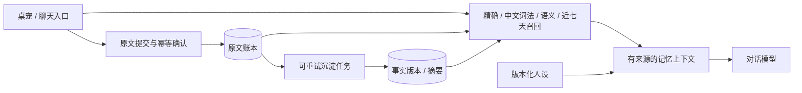

# EverNook · 忆栖

**让共同经历有处安放，让重要的话有据可寻。**

Local-first, evidence-backed long-term memory for AI companions.

EverNook 面向个人桌宠与 AI 陪伴场景：保存多年对话，逐字回取重要交代，在多轮交流中保持上下文，并以可追溯、可修订的方式沉淀事实与回忆。最近一周应当更容易想起，几年前的重要事情也不能被近因排序淹没。

> **当前状态：本地底座已支持原文、重要交代、更正/抑制、工具/文本附件及可选 stdio MCP，尚无生产记忆服务。** [核心契约](docs/contracts/python-text-v1.md)、[附件边界](docs/contracts/capture-v1.md)与 [MCP 配置](docs/contracts/mcp-v1.md)给出真实支持范围；R0 [采集探针](docs/reports/r0-dsh-2026-10-29.md)与[复用对照](docs/reports/r0-core-2026-10-29.md)仍为合成实验。备份、保险库、模型及实际桌面接入尚未启用或验收。

## 我们希望做到什么

- **原话留存**：原始文本先可靠落盘；重要交代保存原文、标点、数字和来源，摘要不替代原文。
- **跨年记忆**：原始记录与可重建索引分离，支持备份、恢复、导出和长期迁移。
- **证据召回**：答案能回到来源消息；区分当前事实、历史事实、角色扮演和模型推断。
- **近期优先**：最近七天有独立召回预算与缓存，同时保留全历史检索路径。
- **受控沉淀**：自动抽取、归纳和去重；更正保留版本，核心人设修改由用户决定。
- **可替换外壳**：桌宠、聊天 UI、LLM 和 embedding 不与记忆资产绑定。

“保存完整原文”“检索到正确证据”“生成忠实回答”是三个独立目标。第一项用完整性与恢复测试验收；后两项用中文跨年测试集验收，不能以模型宣称记住了作为成功证据。

## 推荐起点

独立本地记忆服务，Python + SQLite，先实现可靠原文账本、明确的重要记忆与最小时间版本，再验证中文全文检索和语义召回。FTS5 与 sqlite-vec 是候选组件，具体分词、embedding 与 LLM 提供方待基准验证后确定。

不默认按月分表，不先引入图数据库或分布式组件。先评估复用 MemOS 本地插件的成本，再决定哪些编排需要自己维护；“完全自建一定最优”不是当前结论。

图中仅原文提交、账本和待处理任务记录已有初始实现，其余仍为**拟议设计**。自我沉淀指记忆维护，不代表自动训练模型权重、改写核心人格或执行外部动作。

## 文档导航

| 文档 | 内容 |
|---|---|
| [需求与边界](docs/requirements.md) | 目标、非目标、业务不变量与待决问题 |
| [同类项目与可行性](docs/research.md) | Mem0、Letta、Graphiti、MemOS、Memobase、Open-LLM-VTuber 的一手资料对照 |
| [架构草案](docs/architecture.md) | 写入时序、原文证据、事实版本、七天热记忆与恢复 |
| [路线与验收](docs/roadmap.md) | 复用验证、分阶段实现、正确率与时延测量方法 |
| [贡献指南](CONTRIBUTING.md) | 范围、测试与公开数据要求 |

研究日期：2026-10-29。所有选型与性能目标仍需要真实工程验证。

## 数据与隐私

公开仓库只保存源码、设计与合成样例。私人对话、人设、数据库、向量、备份和密钥放在仓库外，不能提交到 Git。`.gitignore` 是辅助防线，不能替代提交前检查。

“本地优先”不等于所有推理都在本机：如果后续选择云 LLM 或 embedding，发送哪些内容必须显式配置并获得用户认可。第一版服务默认只考虑本机访问，不默认开放公网。

## License

[MIT](LICENSE) © 2026 destinyTaoTao。本文档仅参考其他项目的公开设计，未复制其实现代码；未来引入第三方代码、模型与桌宠素材时应单独核对许可。
