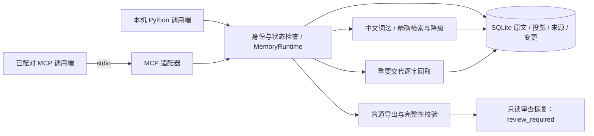

# EverNook · 忆栖

**让共同经历有处安放，让重要的话有据可寻。**

Local-first, evidence-backed memory for agent harnesses and AI companions.

Core0.1.19 adds optional [user-defined topic views](docs/contracts/topic-views-v1.md), with source-backed snapshots, invalidation before refresh and bounded background maintenance. See [verification and quality limits](docs/reports/topic-views-2026-11-13.md); local reasoning and daily model admission remain separate work.

EverNook 是供 dsh、pi、桌宠等接入的外挂长期记忆模块：通过原生插件或 MCP 保存交流，并为聊天上下文提供相关记忆。目标是保存多年对话、逐字回取重要交代、跨会话保持连续性，并以可追溯、可修订的方式沉淀事实与回忆。最近一周应当更容易想起，几年前的重要事情也不能被近因排序淹没。

> **当前状态：已有本地证据账本、CLI/MCP、显式离线语义召回、加密备份、受保护收件箱/本地显示、时态事实、候选抽取、预算上下文、可补跑导航、经验草案、普通来源确认删除、dsh/pi SDK 适配，以及核心人设与用户画像版本化管理、沉淀草案审查与进程内会话/空闲调度、伴侣预设、适配器符合性套件；尚无生产启用或完整产品验收。** 真实支持范围见[当前架构](docs/current-architecture.md)与各项[契约](docs/contracts)。

2026-11-08：[dsh记忆管理预览插件](plugins/dsh/README.md)提供独立页面与会话侧栏、来源/画像/兴趣/时间线、更正/来源抑制和草案审查。独立固定补丁宿主支持可靠工具发布、受限混合流与可信核对后的只读续接；Core0.1.9/preview.21已在新隔离组合完成[原生短验收](docs/reports/dsh-candidate20-validation.md)和[1800秒/180回合合成长跑](docs/reports/dsh-installed-stability.md)，旧组合记录保留。[词法加速与维护候选](docs/reports/m58-followup-84-query-budget.md)的可选覆盖索引由可信维护命令显式启停，维护按ID先选取再回源、复用调用内有界行号查找。目标为Windows本机dsh `0.2.1-rc.5`；Web仍是字符兼容预算，真实模型完整兼容、质量/规模和物理OS门禁仍开放，未启用日常profile。[管理契约](docs/contracts/management-ui-v1.md)与[界面记录](docs/reports/dsh-ui-03-preview.md)说明页面范围。

**2026-10-31 已从换机交接继续开发；`codex/r3-experience-drafts` 的全部增量已于同日快进合入 `main` 并推送。历史状态、依赖重建、已验证结果与待办见[换机交接](docs/handoff-2026-10-31.md)。**

Core0.1.10另提供[显式维护窗口候选](docs/reports/m58-followup-84-query-budget.md)，支持最多5000个候选ID的有界补跑、逐条提交及后续组权限复核；独立安装和大合成副本验证已完成，尚未替换上述Core0.1.9宿主组合或取得新原生/长跑准入。

Core0.1.11候选再提供[可选FTS消息ID加速](docs/contracts/lexical-v1.md#可选fts消息id加速core0111候选)：由可信CLI显式重建/反向恢复，保留原文与派生行号，旧库不自动迁移；与覆盖索引独立，重建需要维护窗口和额外磁盘。独立安装、故障回滚及合成大副本结果核对通过；preview.21组合已补[新原生短验收](docs/reports/dsh-candidate20-validation.md#core0111--preview21-隔离短验收)和[1800秒独立合成长跑](docs/reports/dsh-installed-stability.md#core0111--preview21独立窗口补验2026-11-08)，正式模型/质量/规模/物理OS与日用准入仍待完成。

Core0.1.12另优化[请求内元数据核对和有界候选回源](docs/reports/m58-followup-84-query-budget.md)：不新增持久结构，候选较多时保留原查询路径。815923条已完整回填的合成副本，安装版近期/历史/无答案约2.95–2.98秒、热门词约4.75秒，完整页与旧包一致；已补[自身原生短验收](docs/reports/dsh-candidate20-validation.md#core0112--preview21-隔离短验收)和[1810秒/181回合独立合成窗口](docs/reports/dsh-installed-stability.md#core0112--preview21独立窗口补验2026-11-08)。2秒查询仍超时，正式质量/规模/时延准入仍待完成，Core0.1.11宿主保留、日用关闭。

Core0.1.17增加[完整段落有限偏好处理](docs/contracts/automatic-preferences-v1.md)与[跨会话经历候选](docs/contracts/episodes-v1.md)：临时例外、否定和冲突独立处理，原文及精确依据保留，经历候选仅供审查。独立服务可信CLI与实际dsh下一轮验证见[实施记录](docs/reports/automatic-profile-2026-11-13.md)；默认未准入，日用及模型质量门禁继续保留。

Core0.1.18提供[综合观察基础层](docs/contracts/observations-v1.md)：支持/反例与原始依据版本化，可信发布、撤回、拆分及显式导入重映射；可选后台生成有限偏好待审观察。完整模型综合、主题视图与反思继续单独验收。

## 我们希望做到什么

- **原话留存**：原始文本先可靠落盘；重要交代保存原文、标点、数字和来源，摘要不替代原文。
- **跨年记忆**：原始记录与可重建索引分离，支持备份、恢复、导出和长期迁移。
- **证据召回**：答案能回到来源消息；区分当前事实、历史事实、角色扮演和模型推断。
- **近期优先**：最近七天有独立召回预算与缓存，同时保留全历史检索路径。
- **受控沉淀**：自动抽取、归纳和去重；更正保留版本，核心人设修改由用户决定。
- **可替换外壳**：桌宠、聊天 UI、LLM 和 embedding 不与记忆资产绑定。
- **受保护凭证**：可选加密保存敏感原件，普通记忆使用脱敏投影；本地主口令验证后才能按授权读取明文。

“保存完整原文”“检索到正确证据”“生成忠实回答”是三个独立目标。第一项用完整性与恢复测试验收；后两项用中文跨年测试集验收，不能以模型宣称记住了作为成功证据。

## 当前实现

当前采用 Python 3.14 + SQLite 原文账本，中文词法/精确路径使用可重建 FTS5；可选 stdio MCP 复用同一核心，默认十个只读工具。显式本地 embedding、候选抽取已有固定资产与执行路径，模型质量仍待正式准入；首验范围为 Windows 本机固定 NTFS。普通恢复保持审查限制，加密备份不等于可自动接管的运行库恢复。伴侣场景增量为同一核心上的显式扩展：版本化核心人设（用户确认才生效）、用户画像草案-确认生命周期、沉淀草案进入审查队列（档位与收窄白名单）、进程内会话/空闲触发调度与伴侣预设（推荐值全部可覆盖，非性能承诺）。

2026-11-13更新，Core0.1.16提供[独立记忆服务](docs/contracts/service-v1.md)和[全历史候选/独立检索意图](docs/contracts/long-term-recall-v1.md)。普通账本可在停用旧入口后一次激活服务模式，dsh preview.23的存取查和可信页面统一连接；关闭宿主后，已配置的维护与向量化继续运行。Core0.1.15安装版的[30分钟故障循环](docs/reports/service-cutover-2026-11-12.md)为该版本证据，新版本不继承完整长跑或日常质量/规模准入。已冻结[学习评测基线](docs/reports/learning-baseline-2026-11-13.md)，失败与missing继续保留。现有受保护原件迁移另行验收。后续综合观察、主题认知视图与查询时反思已纳入[总spec #106](https://github.com/destinyTaoTao/evernook/issues/106)。

不默认按月分表，不先引入图数据库或分布式组件。先评估复用 MemOS 本地插件的成本，再决定哪些编排需要自己维护；“完全自建一定最优”不是当前结论。

图中为证据账本的基础调用。dsh/pi 显式 SDK profile 已实现采集/基本召回注入，但未启用日常桌面 profile，桌宠目标尚未指定；没有已部署的共享守护服务。普通归档未加密，另有显式加密备份；恢复不开放普通召回。[当前实现与流程图](docs/current-architecture.md)列出完整增量与缺口；[目标架构](docs/architecture.md)保留后续设计。

候选任务支持来源版本/片段校验、租约重试和失效过滤，本地 Qwen 候选摘录可显式运行；事实与经验接纳需可信本地用户决定。日/周/字面主题导航可以有界补跑，但没有日常后台计划任务。普通来源可在精确预览和用户确认后删除并传播到派生资产，既有备份和宿主副本仍明确保留为残留。详见[抽取](docs/contracts/extraction-v1.md)、[事实](docs/contracts/facts-v1.md)、[导航](docs/contracts/navigation-v1.md)、[经验](docs/contracts/experience-v1.md)与[删除](docs/contracts/purge-v1.md)。

## 文档导航

| 文档 | 内容 |
|---|---|
| [需求与边界](docs/requirements.md) | 目标、非目标、业务不变量与待决问题 |
| [同类项目与可行性](docs/research.md) | Mem0、Letta、Graphiti、MemOS、Memobase、Open-LLM-VTuber 的一手资料对照 |
| [当前实现与架构图](docs/current-architecture.md) | 实现结构、写入/检索/恢复流程、源码职责与真实进度 |
| [目标架构](docs/architecture.md) | 后续事实版本、七天热记忆与完整恢复设计 |
| [路线与验收](docs/roadmap.md) | 复用验证、分阶段实现、正确率与时延测量方法 |
| [统一记忆设计讨论](docs/design-session.md) | 已确认的本地/共享边界、多层记忆、主动沉淀与 dsh/pi 接入提案 |
| [领域术语](CONTEXT.md) | 原始证据、重要交代、事实、经验与遗忘语义 |
| [凭证安全设计](docs/credential-security.md) | 加密保管、锁定写入、本地解锁、逐次明文授权与验收 |
| [贡献指南](CONTRIBUTING.md) | 范围、测试与公开数据要求 |
| [中文评测集](eval/zh-memory-v1/README.md) | 维护者委派 AI 逐条复核的 224 条冻结查询、五分项计分与公开核心基线；模型准入仍待完成 |

研究日期：2026-10-29。所有选型与性能目标仍需要真实工程验证。

## 数据与隐私

公开仓库只保存源码、设计与合成样例。私人对话、人设、数据库、向量、备份和密钥放在仓库外，不能提交到 Git。`.gitignore` 是辅助防线，不能替代提交前检查。

当前产品边界已明确为记忆存储、embedding、抽取、重排和沉淀全部离线，失败不自动转云端。EverNook 不内置聊天；dsh、pi、桌宠等调用端收到记忆后的模型调用和出机策略由调用端负责。第一版服务默认只考虑本机访问，不默认开放公网。

## License

[MIT](LICENSE) © 2026 destinyTaoTao。本文档仅参考其他项目的公开设计，未复制其实现代码；未来引入第三方代码、模型与桌宠素材时应单独核对许可。
