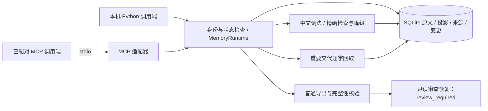

# EverNook · 忆栖

**让共同经历有处安放，让重要的话有据可寻。**

Local-first, evidence-backed memory for agent harnesses and AI companions.

EverNook 是供 dsh、pi、桌宠等接入的外挂长期记忆模块：通过原生插件或 MCP 保存交流，并为聊天上下文提供相关记忆。目标是保存多年对话、逐字回取重要交代、跨会话保持连续性，并以可追溯、可修订的方式沉淀事实与回忆。最近一周应当更容易想起，几年前的重要事情也不能被近因排序淹没。

> **当前状态：已有本地证据账本、CLI/MCP、显式离线语义召回、加密备份、受保护收件箱/本地显示、时态事实、候选抽取、预算上下文、可补跑导航、经验草案及 dsh/pi SDK 适配；尚无生产启用或完整产品验收。** 真实支持范围见[当前架构](docs/current-architecture.md)与各项[契约](docs/contracts)。

**2026-10-31 开发已按用户要求暂停并保存交接。家里电脑请检出 `codex/r3-experience-drafts`；完整状态、依赖重建、已验证结果与待办见[换机交接](docs/handoff-2026-10-31.md)。`main` 尚未合入这组堆叠 PR。**

## 我们希望做到什么

- **原话留存**：原始文本先可靠落盘；重要交代保存原文、标点、数字和来源，摘要不替代原文。
- **跨年记忆**：原始记录与可重建索引分离，支持备份、恢复、导出和长期迁移。
- **证据召回**：答案能回到来源消息；区分当前事实、历史事实、角色扮演和模型推断。
- **近期优先**：最近七天有独立召回预算与缓存，同时保留全历史检索路径。
- **受控沉淀**：自动抽取、归纳和去重；更正保留版本，核心人设修改由用户决定。
- **可替换外壳**：桌宠、聊天 UI、LLM 和 embedding 不与记忆资产绑定。
- **受保护凭证**：可选加密保存敏感原件，普通记忆使用脱敏投影；本地主口令验证后才能按授权读取明文。

“保存完整原文”“检索到正确证据”“生成忠实回答”是三个独立目标。第一项用完整性与恢复测试验收；后两项用中文跨年测试集验收，不能以模型宣称记住了作为成功证据。

## 当前实现

当前采用 Python 3.14 + SQLite 原文账本，中文词法/精确路径使用可重建 FTS5；可选 stdio MCP 复用同一核心，默认九个只读工具。显式本地 embedding、候选抽取已有固定资产与执行路径，模型质量仍待正式准入；首验范围为 Windows 本机固定 NTFS。普通恢复保持审查限制，加密备份不等于可自动接管的运行库恢复。

不默认按月分表，不先引入图数据库或分布式组件。先评估复用 MemOS 本地插件的成本，再决定哪些编排需要自己维护；“完全自建一定最优”不是当前结论。

图中为证据账本的基础调用。dsh/pi 显式 SDK profile 已实现采集/基本召回注入，但未启用日常桌面 profile，桌宠目标尚未指定；没有已部署的共享守护服务。普通归档未加密，另有显式加密备份；恢复不开放普通召回。[当前实现与流程图](docs/current-architecture.md)列出完整增量与缺口；[目标架构](docs/architecture.md)保留后续设计。

候选任务支持来源版本/片段校验、租约重试和失效过滤，本地 Qwen 候选摘录可显式运行；事实与经验接纳需可信本地用户决定。日/周/字面主题导航可以有界补跑，但没有日常后台计划任务。详见[抽取](docs/contracts/extraction-v1.md)、[事实](docs/contracts/facts-v1.md)、[导航](docs/contracts/navigation-v1.md)与[经验](docs/contracts/experience-v1.md)。

## 文档导航

| 文档 | 内容 |
|---|---|
| [需求与边界](docs/requirements.md) | 目标、非目标、业务不变量与待决问题 |
| [同类项目与可行性](docs/research.md) | Mem0、Letta、Graphiti、MemOS、Memobase、Open-LLM-VTuber 的一手资料对照 |
| [当前实现与架构图](docs/current-architecture.md) | 实现结构、写入/检索/恢复流程、源码职责与真实进度 |
| [目标架构](docs/architecture.md) | 后续事实版本、七天热记忆与完整恢复设计 |
| [路线与验收](docs/roadmap.md) | 复用验证、分阶段实现、正确率与时延测量方法 |
| [统一记忆设计讨论](docs/design-session.md) | 已确认的本地/共享边界、多层记忆、主动沉淀与 dsh/pi 接入提案 |
| [领域术语](CONTEXT.md) | 原始证据、重要交代、事实、经验与遗忘语义 |
| [凭证安全设计](docs/credential-security.md) | 加密保管、锁定写入、本地解锁、逐次明文授权与验收 |
| [贡献指南](CONTRIBUTING.md) | 范围、测试与公开数据要求 |

研究日期：2026-10-29。所有选型与性能目标仍需要真实工程验证。

## 数据与隐私

公开仓库只保存源码、设计与合成样例。私人对话、人设、数据库、向量、备份和密钥放在仓库外，不能提交到 Git。`.gitignore` 是辅助防线，不能替代提交前检查。

当前产品边界已明确为记忆存储、embedding、抽取、重排和沉淀全部离线，失败不自动转云端。EverNook 不内置聊天；dsh、pi、桌宠等调用端收到记忆后的模型调用和出机策略由调用端负责。第一版服务默认只考虑本机访问，不默认开放公网。

## License

[MIT](LICENSE) © 2026 destinyTaoTao。本文档仅参考其他项目的公开设计，未复制其实现代码；未来引入第三方代码、模型与桌宠素材时应单独核对许可。
