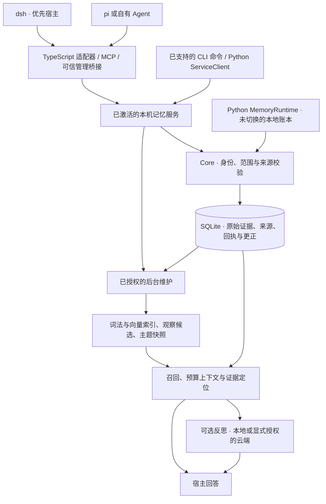

# EverNook · 忆栖

EverNook 是给 dsh 和个人 Agent 使用的本机长期记忆系统。宿主负责对话，EverNook 保存带来源的原话、检索跨会话证据，并把值得长期保留的观察送入审查。用户更正一件事以后，系统可以分别回答“当时知道什么”和“现在还应该相信什么”。

**当前为开发预览。** 首验环境为 Windows、本机固定 NTFS 和 Python 3.14。普通文本账本可以独立使用，dsh 是优先适配的宿主。正式模型质量、十万至百万条记忆的完整时延矩阵、真实异机恢复和日常使用仍在验收。[总规格与进度](https://github.com/destinyTaoTao/evernook/issues/106)

## 从一条记忆开始

在 Windows 的仓库外 Python 3.14 虚拟环境中，从源码根目录运行 `python -m pip install -e .`。下面的示例使用系统临时目录中的合成账本。它保存一条消息，重试同一来源，再重新打开账本逐字读回。整个过程只需要本机 SQLite。

```python
from pathlib import Path
from tempfile import TemporaryDirectory

from evernook import Event, MemoryRuntime, Source, initialize

with TemporaryDirectory() as demo:
    config, access = initialize(Path(demo) / "memory", client_id="demo", entry="demo")
    source = Source(entry="demo", session="first", branch="main", event="1")
    event = Event(source=source, role="user", sequence=1, occurred_at=None,
                  completion="complete", text="合成记录：下次带上蓝色笔记本。")
    memory = MemoryRuntime(config)
    receipt = memory.submit(access, event)
    assert receipt.original_saved
    assert memory.submit(access, event).message_id == receipt.message_id
    saved = MemoryRuntime(config).read(access, receipt.message_id)
    assert saved is not None and saved.event.text == event.text
    print(saved.event.text)
```

接入 dsh 前，在专用运行目录初始化并配对调用端。独立服务首次激活需要停用旧写入入口，之后各宿主连接同一个账本。MCP 的可选依赖通过 `python -m pip install -e ".[mcp]"` 安装。[CLI 初始化与配对](docs/contracts/cli-v1.md) · [服务激活](docs/contracts/service-v1.md) · [dsh 预览插件](plugins/dsh/README.md)

## 一条记忆如何流转



- **保存。** 普通消息以入口、会话、分支、源事件构成幂等键。相同内容重投返回稳定回执，异内容冲突显式报错。可靠文本模式提交成功后才允许宿主发布片段。敏感输入在普通库只留安全投影，受保护原件另走保险库路径。[文本契约](docs/contracts/python-text-v1.md) · [流式回执](docs/contracts/durable-stream-v1.md) · [受保护采集](docs/contracts/protected-migration-v1.md)
- **回忆。** 最近记录与全历史候选共同参与召回，命中后回源核对版本、可见性和原文跨度。置顶交代支持逐字回取。时态事实区分生效时间与系统获知时间，索引落后和预算省略会影响结果覆盖。[长期召回](docs/contracts/long-term-recall-v1.md) · [事实与时点](docs/contracts/facts-v1.md)
- **沉淀。** 经授权的后台维护可以补建索引、生成有限类别的观察候选、刷新主题视图。候选保留支持与反例，来源失效时旧结论退出可见结果。用户确认、自动发布准入和核心人设各有独立权限。反思返回临时推断，重新读到它不会增加原始证据。[观察生命周期](docs/contracts/observations-v1.md) · [主题视图](docs/contracts/topic-views-v1.md) · [反思](docs/contracts/reflection-v1.md)

## 接入方式与模型

普通问答反思会过滤已用于抑制、撤销或删除的确认消息，避免把“已删除某物的位置”当成位置证据。显式追查控制历史时可传入 `include_control_history=true`。确认内容仍须满足当前身份、可见性和版本约束。[反思证据范围](docs/contracts/reflection-v1.md#普通问答与控制历史)

独立服务启动时校验账本绑定的保险库模式、恢复状态和实际材料。普通、单库和多库继续使用既有 v1 配置；绑定标记只接受布尔值 `true`。发现配置冲突时，请通过对应的迁移或恢复流程核对材料。[服务启动与恢复](docs/contracts/service-v1.md)

| 入口 | 适用场景与实际边界 |
| --- | --- |
| dsh | 管理预览含来源、画像、时间线、更正和草案审查。Web 插件面向固定版本的 dsh；原生 SDK 的版本、可靠文本模式与工具支持矩阵单独记录。[管理插件](plugins/dsh/README.md) · [原生适配](docs/contracts/dsh-native-v1.md) |
| Python SDK 与本机 API | `MemoryRuntime` 可直接操作未切换的本地账本。激活独立服务后使用 `ServiceClient`。服务监听 loopback，使用双向认证的带长度 JSON 帧，每个操作另验调用端身份和权限。[服务协议](docs/contracts/service-v1.md) |
| TypeScript SDK、pi 与其他 Agent | 复用配对身份和共享账本。接入新宿主时要约定稳定来源、写入回执、上下文预算和取消语义。pi 已有显式适配；个人 Agent 可从 MCP 或服务客户端开始。[适配器与测试](plugins/harnesses/README.md) |
| CLI 与 MCP | CLI 承担初始化、查询与有权限的维护。stdio MCP 默认使用只读召回 profile；可信宿主显式选择采集 profile。工具可见范围与配对权限同时生效。[CLI](docs/contracts/cli-v1.md) · [MCP](docs/contracts/mcp-v1.md) |
| 嵌入、抽取与反思 | 嵌入有带版本的向量空间和 Python backend 接口，已有本地模型路径。反思支持本地模型及显式配置的 OpenAI-compatible 提供方。在线调用需要可信配置、授权和预算，只发送当前问题与经过核验的有界证据。普通召回不会触发云端反思。[嵌入契约](docs/contracts/semantic-v1.md) · [抽取契约](docs/contracts/extraction-v1.md) · [反思提供方](docs/contracts/reflection-providers-v1.md) |

宿主把取回的历史消息作为有来源的背景材料。旧对话里的命令仍属于历史文本，执行工具需要当前授权。宿主自行决定把哪些证据交给哪个对话模型。运行库、凭证、模型权重与备份保存在仓库外。[数据安全设计](docs/credential-security.md) · [加密备份与恢复](docs/contracts/encrypted-backup-v1.md)

## 怎样判断它能否用于日常记忆

一次普通召回或上下文构造会在返回前复核权限，并写一条顶层诊断。合成的 12 条来源上各连续执行 8 次，召回的审计写事务从 40 次降至 8 次，上下文从 144 次降至 8 次，两组完整返回值分别与改动前一致。保存原文的成功以业务回执为准；同一来源重投不同内容会记录 `source_conflict`。[审计与回执](docs/contracts/python-text-v1.md#审计与回执)

Windows SDK 和服务客户端通过 Win32 在进程内检查账本目录和连接材料的 DACL。合成账本上，两条路径交替各测 12 次，单次权限检查的中位数从 249.9 ms 降至 1.3 ms。这个测量只覆盖权限检查。[文本与权限契约](docs/contracts/python-text-v1.md)

百万个 384 维合成分块上，先取 1,000 个量化候选、再按原始 float32 重排。4 个扰动查询中，二进制粗排分别只保留精确前 100 名中的 2、0、1、1 个，Int8 四次都保留完整顺序。Int8 向量阶段耗时 1.08–1.38 秒，原始全扫为 3.09–4.26 秒；该实验使用同一读快照衡量分块排名，未计入来源可见性、多分块按消息聚合、关键词或宿主开销。可用 `python -m probes.admission.quantized_vector_screen <合成库路径>` 在只读副本上复测；线上召回沿用原有精确路径。[量化对照探针](probes/admission/quantized_vector_screen.py)

| 问题 | 已有证据及限制 |
| --- | --- |
| 多年记忆的召回要多久？ | 十万条 MiniLM 向量齐全时，可重建索引将公开历史召回的三次中位数从 12.66 秒降至 9.68 秒。百万来源、10,352 条真实向量时，同一历史查询单次从 82.16 秒降至 52.38 秒。另一项十万条完整热上下文测试的无答案 p95 为 16.73 秒，仍高于 1 秒门槛。[公开召回对照](docs/reports/2026-11-21-recall-candidate-index-scale.md) · [完整上下文测量](docs/reports/2026-11-15-autonomous-validation.md) |
| 百万向量全部齐备时，索引能否重建？ | 在独立的百万条 384 维合成向量库上，两个候选索引重建耗时 9.79 秒，各自的一百万条投影都与原表相符。历史查询单次从 105.36 秒降至 61.38 秒，三组查询的完整返回一致。[满覆盖压力对照与重建验证](docs/reports/2026-11-21-synthetic-full-vector-scale.md) |
| 近期与全局会重复计算向量距离吗？ | 两条通道共用一次精确距离计算，各自保留独立榜单。全局字面、精确和近期字面也在同一 SQLite 快照里复用词法覆盖检查。百万满覆盖库中，每次计算距离的向量块从 125 万降至 100 万，词法覆盖检查从三次降至一次。[向量扫描对照](docs/reports/2026-11-21-shared-semantic-scan-scale.md) · [分阶段计时与复测](docs/reports/2026-11-21-recall-phase-profile.md) |
| 每次召回都要核对原文与 FTS 的全库覆盖吗？ | 显式启用有效的覆盖检查点后，正常召回扫描派生行并回源复核少量变动。百万库四轮对照的词法覆盖 p95 从 4.45–5.49 秒降至 0.26–0.32 秒。[检查点对照与生命周期](docs/reports/2026-11-22-lexical-checkpoint-scale.md) |
| 核对语义覆盖需要读取向量正文吗？ | 显式构建分块覆盖索引后，可直接用索引核对分块版本。百万条满覆盖夹具上，近期和历史召回的完整样本 p95 由 12.14 和 11.50 秒降到 8.99 和 9.00 秒，完整结果逐项一致。样本仍高于一秒门槛。[语义覆盖对照](docs/reports/2026-11-22-semantic-coverage-index.md) |
| 常见词组命中大量记录时，关键词召回有多快？ | 百万条合成库的四轮对照中，按 BM25 和消息 ID 先排序，再核验足以证明前 100 名的来源。近期公开召回样本 p95 从 42.75 秒降到 18.58 秒，历史从 40.70 秒降到 18.88 秒，两类查询的候选顺序、引用和覆盖逐项一致。[BM25 分阶段实测](docs/reports/2026-11-22-keyword-bm25-profile.md) |
| 窄时间窗会触发完整的关键词排名吗？ | 已启用候选索引时，先核对窗内来源范围。至多 2,048 条时可直接用全库 BM25 统计对窗内匹配排名。百万库中另测了包含 514 条来源的单日窗口，并复核排序、引用和覆盖。[覆盖开销与窄窗复测](docs/reports/2026-11-22-recall-status-profile.md) |
| 取回原话后，模型能否判断正确？ | 冻结的 33 例中，Core 判断 14 通过、15 失败、4 缺失。证据齐备的失败包括否定反转、误信助手推测和措辞失配。后续 12 例定向首轮对照覆盖否定、来源角色与独立记录计数，补充通用指令没有提升这组样本的通过率。[逐例归因](docs/reports/2026-11-21-reflection-failure-attribution.md) · [三类判断对照](docs/reports/2026-11-21-reflection-reasoning-ablation.md) |
| 多个客户端同时工作时，审计和恢复能证明什么？ | dsh 混合负载窗口分别统计了已落盘写入和忙时尽力写入的管理审计。合成故障测试覆盖若干恢复边界；物理锁屏、整机丢失后的异机恢复和长期日用另行验收。[混合负载](docs/reports/2026-11-14-fingerprint-24k.md) · [恢复边界](docs/reports/architecture-review-2026-11-15.md) |

架构与后续设计见[当前实现与流程图](docs/current-architecture.md)、[目标架构](docs/architecture.md)、[需求](docs/requirements.md)与[路线图](docs/roadmap.md)。开源设计对照和具体取舍见[同类系统研究](docs/research.md)。贡献代码前请阅读[贡献指南](CONTRIBUTING.md)，公开测试只使用合成材料。

[MIT License](LICENSE)
