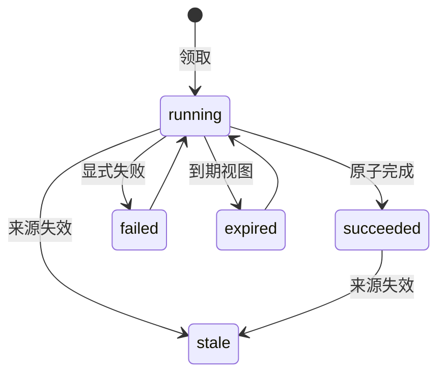

# T12 增量：可恢复任务与事实候选 v1

对应 [Issue #13](https://github.com/destinyTaoTao/evernook/issues/13)。本轮已确认仅实现任务与候选底座，真实模型继续关闭。接口是可信本地 Python 维护操作，不提供抽取模型、自动调度、MCP 工具或事实自动接纳，不解除 T13 的时态/事实接纳准入。

## 入口与使用

`CandidateWorkflow(memory)` 复用已初始化 `MemoryRuntime` 的鉴权、受保护目录、同一 SQLite 连接规则和来源状态；核心无新依赖。所有方法需要有效 `Access` 和契约 v1。普通已授权身份默认共享候选查看能力；执行完成/失败还必须匹配领取时的客户端与租约令牌。此维护入口不注册到普通模型工具。

```python
from evernook import CandidateDraft, CandidateWorkflow, EvidenceSpan

# memory/access 来自已有本地运行时；receipt 对应已提交的短合成用户原文。
workflow = CandidateWorkflow(memory)
lease = workflow.begin(access, (receipt.message_id,), processor_version="synthetic-v1")
if lease.token is not None:
    source = lease.sources[0]
    message = source.message
    draft = CandidateDraft("合成候选：小林喜欢乌龙茶。", "user_statement", (
        EvidenceSpan(message.receipt.message_id, source.state_version,
                     message.receipt.representation, message.receipt.content_version,
                     0, len(message.event.text), message.event.text),))
    result = workflow.complete(access, lease.status.run_id, lease.token, (draft,))
    candidates = workflow.candidates(access, result.run_id)
    assert candidates[0].status == "candidate"
```

示例只展示显式提交合成候选，不代表代码能够自动抽取上述结论。生产抽取模型及调用逻辑尚未接入。

| 方法 | 行为与失败 |
|---|---|
| `begin(access, source_ids, processor_version=..., lease_seconds=300)` | 领取明确来源范围的任务；输入必须是 1–16 个 ID 的 tuple，按集合排序去重；租约为 1–3600 整数秒。来源必须已持久化、当前 active、complete，角色为 user/assistant/tool。返回状态、临时令牌与读取快照 |
| `complete(access, run_id, token, drafts)` | 提交 0–32 个候选；逐项校验后，同一短事务写入全部候选与成功状态。不匹配来源、过期租约、已失效来源、忙锁或存储失败均不假成功 |
| `fail(access, run_id, token)` | 显式报告处理失败，保存固定 `extractor_failed`，不接收或保存模型异常详情；之后可重新领取 |
| `status(access, run_id)` | 查询尝试次数、处理版本、来源范围、状态、固定失败码、租约期限及批次水位，不返回明文令牌 |
| `candidates(access, run_id)` | 只返回成功且所有输入来源仍有效的候选。其余返回空 tuple；通过 status 区分运行、失败、过期、失效和成功无候选 |

领取成功后已无数据库事务，调用端可在外部计算、等待或调用未来获准的离线模型，再显式完成。当前实现没有提供任何模型回调、联网推理或云端 fallback。可信调用端未来如何执行推理仍需单独验证，不把普通 Python API 当作可约束任意调用端行为的沙箱。

## 幂等、租约与恢复

任务身份绑定来源集合、每条来源状态版本、表示/内容版本和 `processor_version`。同范围/版本只有一个有效租约；并发领取的另一个请求得到 `candidate_run_busy`。成功任务再次 begin 返回已有状态与 `token=None`；相同租约重复提交同一结果返回稳定状态，重复候选与候选顺序差异不增加记录。同一已成功任务提交不同内容得到 `candidate_result_conflict`。

不同处理版本或不同来源范围各自形成任务；当前不跨重叠批次做语义去重，也不按文本相同合并两次真实来源。

令牌绑定领取客户端和尝试，只返回调用端，数据库仅保存受独立 HMAC 密钥保护的摘要。新租约轮换令牌并增加尝试次数；旧令牌不能完成或终止新尝试。活跃租约丢失或进程退出时等待到期后重领，不假装可以恢复丢失令牌。租约使用系统 UTC 时间，依赖本机时钟；本轮不实现心跳续期或终止外部计算。



来源失效的查询视图也覆盖 failed/expired，不自动修复或重新接纳来源。进程在领取后或完成提交前退出，未确认结果可以在租约过期后重试；完成提交后退出，任务状态和候选同时保留。候选校验失败或 SQLite 失败会回滚本次完成，原租约保持原状态；调用端可提交有效结果、显式 fail 或等待过期，不把一次拒绝当作结果已保存。成功状态更新前复查租约，处理期间到期则回滚；短事务内无模型调用。

`source_watermark` 是**本批输入**的最大接收时间；`completed_watermark` 仅在成功且来源仍有效时返回该值，否则为 `None`。两者不证明全局连续处理完成，也不证明其他更早来源已处理。原始 `jobs` 仍保持待处理状态，本轮不冒充自动抽取消费者已经运行。

## 候选、来源与安全

`CandidateDraft` 只含文本、provenance、来源片段 tuple 和 disputed 布尔值。结果状态只能是 `candidate` 或 `disputed`，没有 accepted/current、模型置信度或自动启用规则。完成状态 succeeded 只表示候选批次已可靠保存。

- 文本非空、严格 UTF-8，最多 4096 个 code point；来源为 1–16 个 `EvidenceSpan`，每段最多 16384 个 code point。
- 每段绑定消息 ID、状态版本、original/projection 表示、内容版本和 `[start,end)`，必须与当前原文逐字匹配；不混用 UTF-16、字节和投影坐标。
- 来源必须在领取范围内。任一批次来源更正/撤销/抑制后，整批保守失效；状态显示 stale，候选读取返回空。提交前也检查来源，旧结果不能重新发布。有效来源的候选需要由新的有效范围重跑。
- provenance 为 `user_statement`、`assistant_generated`、`quoted` 或 `roleplay`，由可信处理端声明；user_statement 只能引用 user，assistant_generated 只能引用 assistant。代码校验角色和片段，**不证明语义蕴含、不自动识别引文/角色扮演或判断真假**，错误分类不能因此获得已接纳事实地位。
- 已有脱敏投影可作为任务输入，但 v1 是整条保护占位，不能为其生成事实候选；允许提交零候选。不会解密受保护原件。敏感候选文本在普通持久化前拒绝；检测覆盖沿用有限信号，不能承诺零漏检。
- 候选不写回原始消息、不进入 FTS 或普通上下文，不授予人设/工具权限。来源文本继续是不可信数据。

派生表 `candidate_runs_v1`、`fact_candidates_v1` 在第一次有效 begin 时同库创建，核心原文 schema 仍为 v4；原文、重要标记和既有变更不被迁移重写。普通归档会保留这些表的快照，但不包含 HMAC 密钥或明文租约令牌，恢复副本仍只能审查，不恢复任务执行身份。

## 验证范围与后续

回归针对统一记忆外部边界，使用仓库外合成数据，覆盖来源/Unicode、重复/版本、并发领取、失败/过期重试、角色/投影、来源失效、身份/令牌、SQLite 忙锁和页配额 FULL，以及领取后/完成 COMMIT 前/成功后进程退出。进程退出不等于物理掉电，页配额不等于实际填满磁盘。

待办包括真实离线模型与断网/质量准入、自动任务选择和调度、事实接纳与时态、多来源事实合并、日周沉淀，以及租约续期/外部任务取消和规模性能。本轮不关闭完整 T12、不解除 T13，不启用日常运行库或备份。
