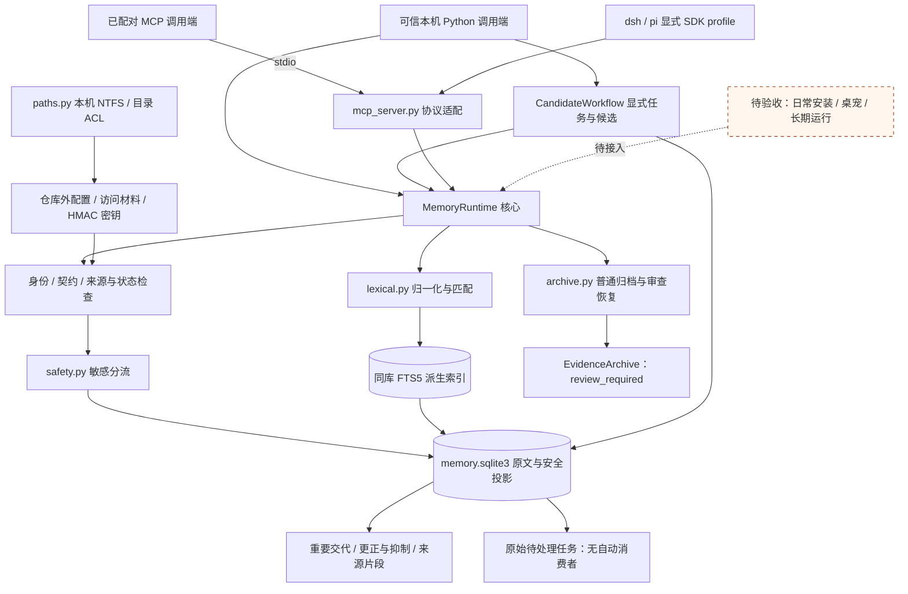
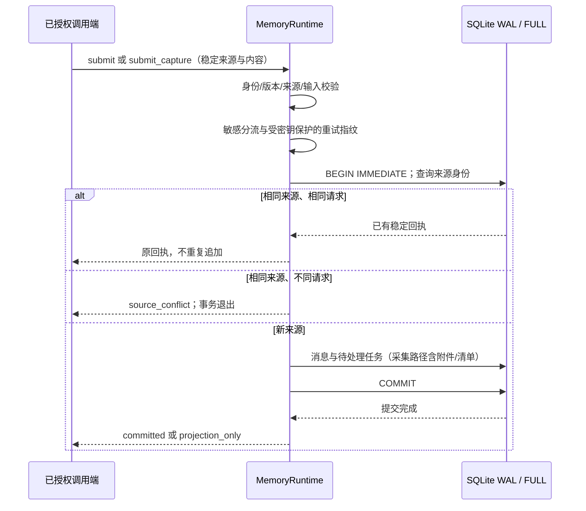
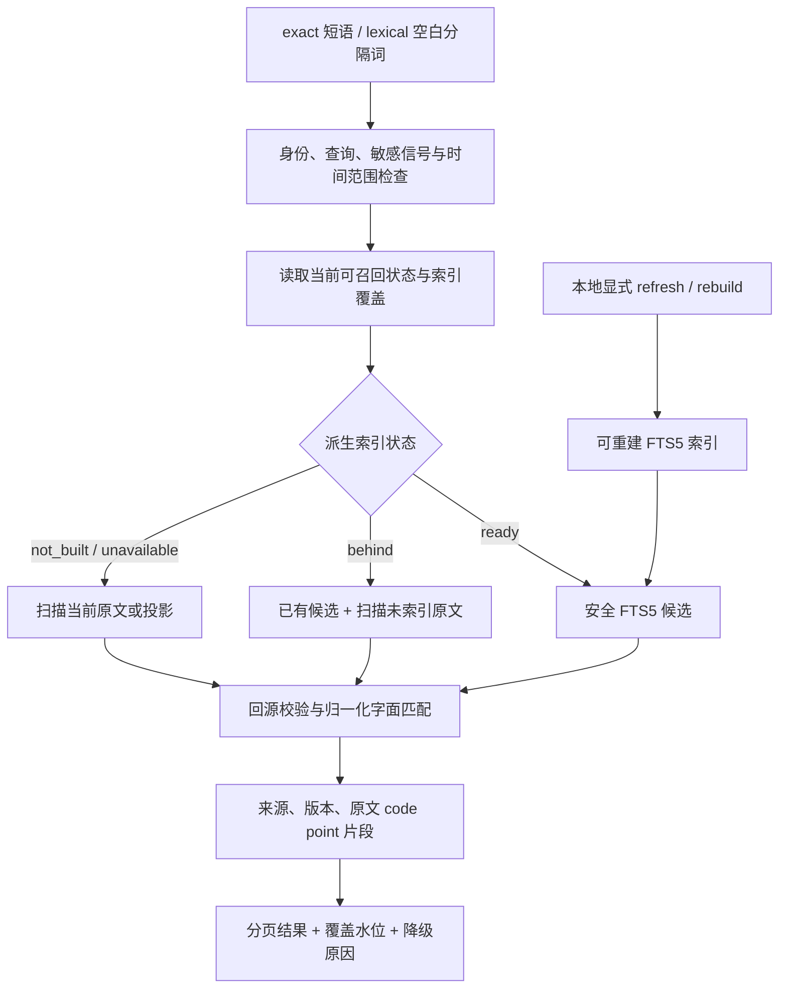
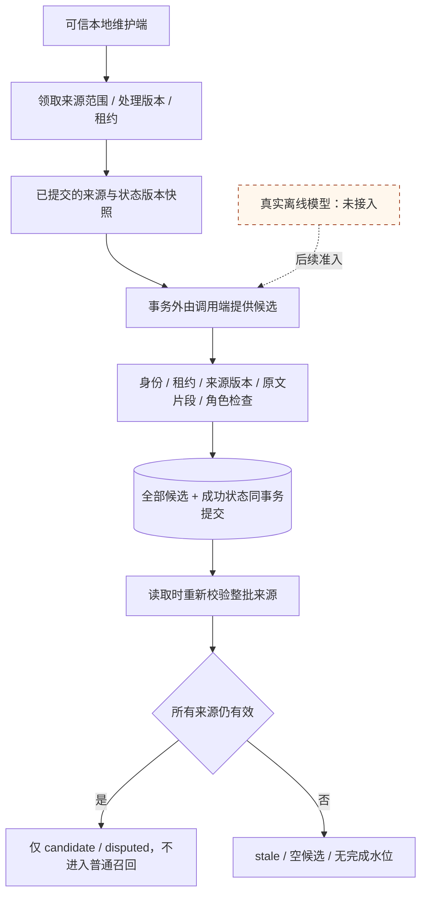
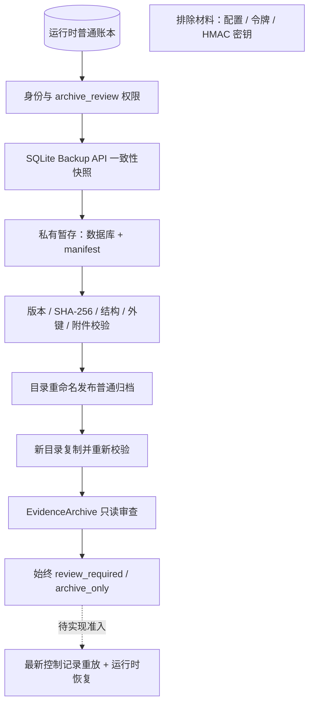

# 当前实现与架构图

更新：2026-10-31，功能基线 `893b5d6` 加本轮 T19 普通来源删除增量（PR31至42的线性堆叠，开发分支 `codex/r3-experience-drafts`）。本页依据源码与契约描述已有能力；[换机交接](handoff-2026-10-31.md)保存此前暂停点和恢复步骤。[目标架构](architecture.md)和[验收路线](roadmap.md)中的后续设计不代表已经实现。

## 系统结构

当前交付为 Python 本地库、可信[本地 CLI](contracts/cli-v1.md)、可选 stdio MCP 及显式 dsh/pi SDK 适配。不同实例可读取同一配置和 SQLite 账本；没有已部署的守护服务、HTTP 监听或日常宿主启用。普通核心无第三方运行依赖；MCP、加密能力分别是可选依赖。MCP 默认九个只读工具，可信启动端选择 trusted-host 才增加六个普通写入/批量工具，事实/经验接纳和保险库解锁均不作为模型工具开放。

实线表示已存在的调用或数据关联，虚线表示规划接入；图中各模块不是独立服务。配置、访问材料、数据库、归档和模型资产均位于 checkout 外。ACL 防止普通其他账户直接访问文件，不隔离同账户恶意代码或管理员。

| 源码 | 当前职责 |
|---|---|
| [runtime.py](../src/evernook/runtime.py) | 配置/配对、鉴权、SQLite 事务、幂等、原文/附件、重要交代、更正/抑制与词法维护入口 |
| [models.py](../src/evernook/models.py) | 版本化输入、来源、回执、状态、分页和检索结果 |
| [safety.py](../src/evernook/safety.py)、[paths.py](../src/evernook/paths.py) | 有限凭证信号检测，以及受支持文件系统与运行目录权限检查 |
| [lexical.py](../src/evernook/lexical.py) | Unicode 归一化、中文 1/2/3 字 gram、安全词项与原文坐标映射 |
| [cli.py](../src/evernook/cli.py) | 可信本地初始化/配对、stdin JSON 保存与检索、指定回取、状态及词法维护；无 MCP 依赖 |
| [mcp_server.py](../src/evernook/mcp_server.py) | 默认九个查询工具，可信宿主模式十五项；固定权限与失败回执，复用核心检查 |
| [semantic.py](../src/evernook/semantic.py)、[embedding.py](../src/evernook/embedding.py) | 显式本地模型空间与可重建向量、RRF 融合、自适应近期范围、来源过滤与降级；不自动启用模型 |
| [archive.py](../src/evernook/archive.py) | 一致性普通快照、清单/哈希校验、恢复发布与只读归档审查 |
| [candidates.py](../src/evernook/candidates.py) | 显式任务租约/重试、来源绑定的候选批次提交与失效过滤；不运行模型或接纳事实 |
| [facts.py](../src/evernook/facts.py)、[extraction.py](../src/evernook/extraction.py) | 显式时态决定/历史知识查询；固定本地模型只生成有来源的候选摘录，不自动接纳 |
| [context.py](../src/evernook/context.py) | 宿主提供 tokenizer 的完整 payload 预算、必读/事实/已审查经验/原文与最终校验 |
| [maintenance.py](../src/evernook/maintenance.py)、[experience.py](../src/evernook/experience.py) | 有界可补跑摘录导航、经验草案与指定版本用户审查，无自动执行权限 |
| [purge.py](../src/evernook/purge.py) | 精确范围预览/用户确认、两阶段普通来源删除、派生传播与来源墓碑；不处理受保护资产或外部副本 |
| [backup.py](../src/evernook/backup.py) | 显式认证加密快照、恢复材料及保留；恢复仍需审查 |
| [protected.py](../src/evernook/protected.py)、[vault_local.py](../src/evernook/vault_local.py) | 显式加密 Event 收件、可恢复关联与本地主口令单次显示；无自动宿主分流 |
| [plugins/harnesses](../plugins/harnesses) | 固定版本 dsh/pi 内核适配、整次输出保存后发布、共享普通记忆与基本证据注入 |
| [tests/contracts](../tests/contracts) | 公开边界的合成回归，含真实 stdio、并发与进程退出场景 |
| [probes](../probes) | R0 宿主、模型和加密原语实验，不作为正式适配器或启用状态 |

## 写入与保存确认

来源为入口、会话、分支、源事件 ID 的组合；相同文本的不同真实事件分别保留。SQLite 提交失败不能返回成功。核心使用短事务，尚无统一后台写调度器或自动抽取消费者；候选任务需由可信本地维护端显式领取/提交。

保险库关闭时，声明或检测为敏感的内容只保存投影，并明确 `original_saved=false`；有限检测不保证任意秘密均可识别。重要标记、更正/抑制是各自显式操作，不应从上图推断一次普通提交会自动完成它们。

工具与有界文本附件同事务保存，缺失、超限、不支持和未完成内容报告缺口。显式 stream 路径和 dsh/pi 包装会整次缓冲，完整保存后再发布，尚无实时逐 token 显示。pi 的明确包装工具有同类屏障；dsh 原生工具最终结果的通用 awaited seam 仍缺失。真实日常 UI/恢复/多插件组合未验收。见[采集](contracts/capture-v1.md)、[dsh](contracts/dsh-native-v1.md)与[pi](contracts/pi-native-v1.md)。

## 当前检索与降级

`exact` 对整个短语匹配，`lexical` 对空白分隔词执行 AND；两者均使用派生归一化表示，返回原件或投影对应的坐标。查询文本按字面处理，不执行用户的 FTS 语法。

普通读取和候选路径过滤已更正、撤销或抑制的消息；索引维护提交前重新核验来源状态。索引落后时补扫未处理原文；索引失败时扫描原文，明确报告覆盖缺口。水位是最大接收时间，不能代替连续完成证明。原文数据库失败仍报存储错误，不伪造空结果。

独立附件内容尚未进入全文检索。[显式语义召回](contracts/semantic-v1.md)融合字面与固定本地 embedding，近期窗口按天数与内容量扩展，保留全历史路径。已有独立[时态事实](contracts/facts-v1.md)与[预算上下文](contracts/context-v1.md)，不等于自然语言时间/主体自动推断或模型质量准入；原生适配仍使用基本字符预算注入，尚未完整接线 tokenizer 构造器。

## 候选任务与来源校验

同范围/来源版本/处理版本幂等；并发只有一个有效租约，失败或租约过期后以新令牌重领。令牌只返回领取端，数据库只留 HMAC 摘要。任务成功、候选和可见完成水位一致；水位只针对本批输入，不代表更早记录均已处理。原始 jobs 仍为 pending，尚无自动任务选择或消费。

候选必须匹配来源表示、版本和 code point 片段；模型置信度没有接纳权限。角色校验和声明的引文/扮演分类不等于语义判真，所有结果都保持 candidate/disputed。任一批次来源更正、撤销或抑制后，整批保守失效。没有自动事实接纳、历史有效期判断或真实模型调用。详见[候选契约](contracts/candidates-v1.md)。

## 普通来源确认删除

`PurgeWorkflow` 只接受精确来源范围的持久化预览和预览之后的真实用户确认。第一阶段同事务复查版本/依赖并提交 `purged` 状态与无正文来源墓碑，立即阻断读取、召回和旧采集重试；第二阶段可恢复地清理普通原文、附件、重要交代、候选、事实、经验、上下文、词法/语义索引及导航旧摘要。混合派生记录删除或从剩余证据重建，范围外相同附件内容不误删。

清理中断保持不可召回并可用原决定续清；阻断期间新 capture 不能引用已不处于 `active` 状态的目标（`not_recallable`），同源幂等重试不受影响，因此中断不会因新增依赖而永远无法续清。既有归档/加密备份不会自动改写，宿主副本不受控制，回执始终报告这些残留；受保护来源拒绝走普通删除。删除记录进入后续快照，但旧备份控制重放和运行时恢复尚未实现。可信 CLI 提供预览/执行，MCP 无删除工具。详见[删除契约](contracts/purge-v1.md)。

## 普通导出与受控恢复

普通归档是未加密的用户证据，包含已失效原档供明确审查；它不是可自动接管的运行时备份。新目录恢复不生成配置或密钥，不提供普通 `read/search/submit`。无法证明快照之后的更正/抑制/删除完整，因此没有把恢复副本转为可召回状态的接口。图中虚线仅表示后续准入缺口，排除材料不进入归档。详见[归档契约](contracts/archive-v1.md)和[实施验证](reports/r1-export-2026-10-30.md)。

## 实现进度与阶段缺口

| 阶段/能力 | 当前事实 | 尚未完成 |
|---|---|---|
| R0 验证与选型 | 已有 dsh、MemOS 对照和凭证原语探针；原文账本路线已记录 | 全面 OS 断网、正式模型质量、实际宿主集成等准入 |
| R1 可靠底座 | 原文/重要交代/变更/有限附件；普通归档、显式加密备份/恢复材料/保留 | 最新控制重放、运行库恢复、独立盘/调度/RPO/RTO正式验收 |
| R2 事实与时态 | 候选租约与失效过滤；本地候选摘录；显式事实/纠错/变化/计划/争议与知识时点 | 模型质量准入、自动抽取调度/合并、主体解析与复杂时间回填 |
| R3 召回与沉淀 | 字面/本地语义/自适应近期；完整预算构造器；可补跑摘录导航；经验草案/审查 | 原生 tokenizer 接线、生成式摘要质量、空闲调度、语义争议传播、索引迁移/规模性能 |
| R4 跨入口与长期运行 | 真实 stdio、dsh/pi SDK、共享召回与保存/发布/取消回归 | 日常安装、多插件/分支/压缩全验收、桌宠目标、升级/系统离线与长期运行 |
| 独立安全与质量 | 有限分流/ACL；加密Event收件、本地主口令单次显示；普通来源确认删除与派生清理 | 自动分流/附件、IPC逐次授权、WTS锁定、轮换/恢复/泄露治理、受保护/备份删除与正式质量集 |

MCP 默认九个查询工具，可信宿主模式十五项，包含有限 capture/capture_stream；候选/事实/经验接纳、彻底删除、配对、索引维护、归档导出及保险库明文操作均不对模型开放。协议与SDK回归通过不表示日常宿主已经安装、启用或完成产品验收。

归档历史验证见[归档报告](reports/r1-export-2026-10-30.md)，任务与候选验证见[候选报告](reports/r2-candidates-2026-10-30.md)，本轮删除验证见[删除报告](reports/r3-purge-2026-10-31.md)。本页不将测试数量、R0 小样本耗时或约 1 秒目标解释为生产质量/性能验收。

## 后续推进边界

T09仍开放，已实现加密快照与保留，最新控制重放和运行库恢复仍待完成。T19已有普通来源删除增量，但受保护资产、可控备份清理及旧备份重放未闭合。T10/T25已有SDK链路，但日常启用依赖未解除。模型正式启用及其他任务仍需质量和资源准入。后续从[交接](handoff-2026-10-31.md)继续，不把目标、代码存在或合成回归当作产品已验收。
