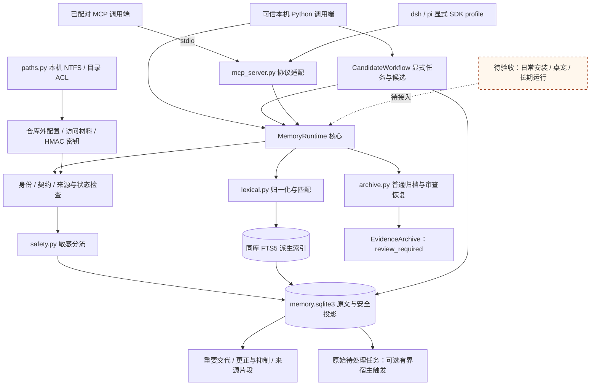
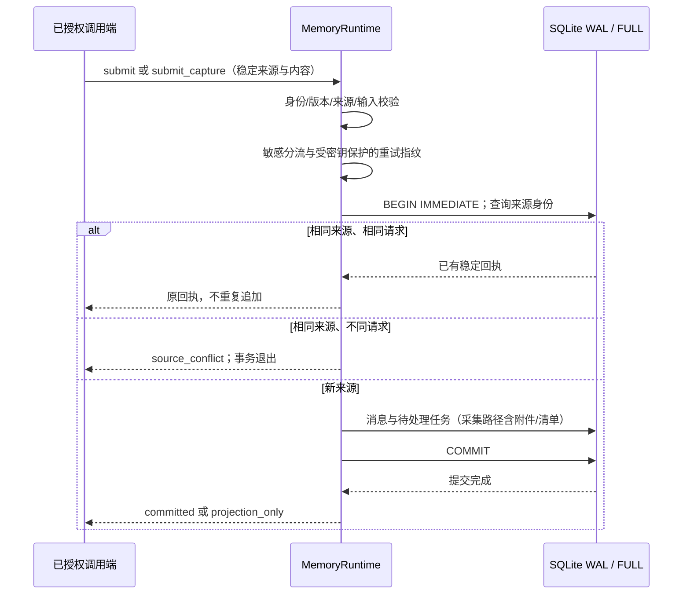
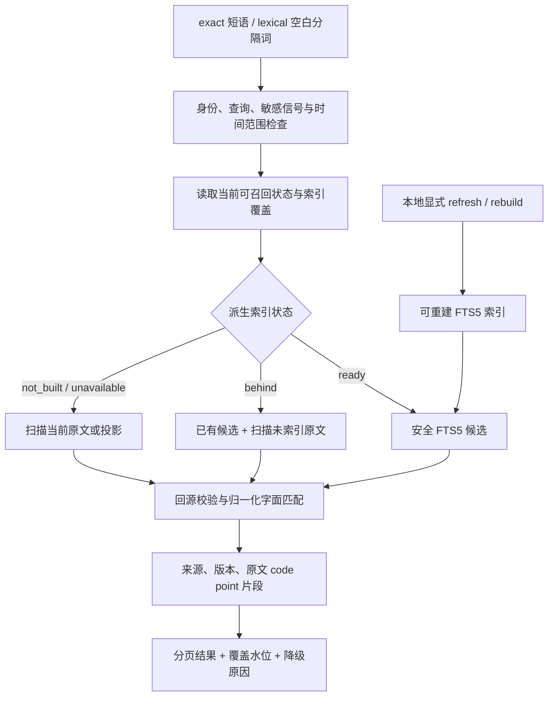
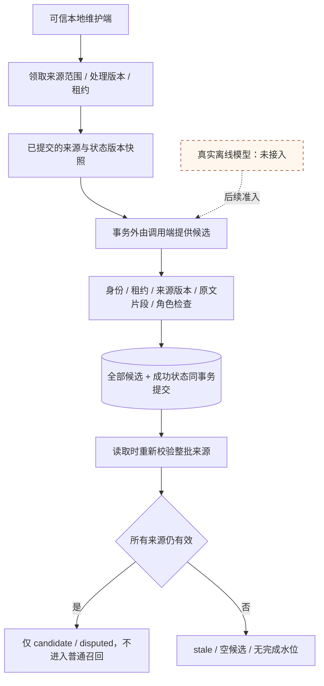
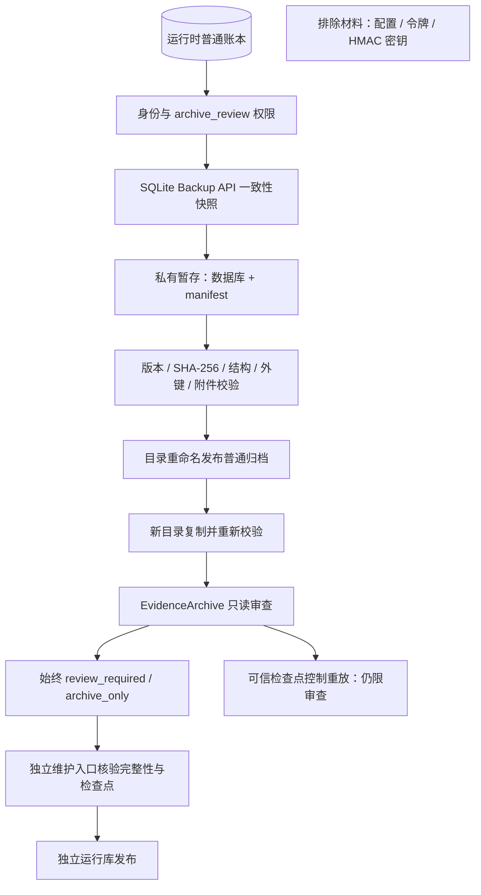

# 当前实现与架构图

> **2026-11-08 独立Core0.1.6候选：** [覆盖统计优化](reports/m58-followup-84-query-budget.md)移除重复回表，不改来源/版本判定或数据库格式。815923条既有合成副本的完整热门词小样本从约3.8–4.1秒降至3.3–3.7秒，整页一致；79项相关源码回归、安装45文件与实际SDK→stdio核对通过。另建隔离dsh/preview.21 profile的[原生9场景短验收](reports/dsh-candidate20-validation.md#core016--preview21-隔离短验收)及失败恢复、重启、卸载后只读拒绝通过，词法索引从8/454追平454/454。随后在另一新环境完成[独立1800.0005秒/180回合窗口](reports/dsh-installed-stability.md#core016--preview21独立窗口补验2026-11-08)：全部预定动作通过、业务错误/应用外网尝试0，采样峰约722MiB，9次查询失败保留，词法/导航6982条收敛且DB一致。时延与完整质量/规模/p95门禁仍未通过，旧Core0.1.5环境保留，日用未启用。

> **2026-11-08 既有Core0.1.5组合长跑：** Core0.1.5/preview.21在全新隔离profile完成1800.012秒/180回合；取消、拒绝、宿主/客户端重启和只读新写拒绝均通过，业务错误/应用外网尝试0。采样峰约730MiB，7次查询失败保留，词法/导航6982条收敛且DB一致性正常；通用沉淀任务未处理。[独立记录](reports/dsh-installed-stability.md)。Web仍是字符兼容，真实模型、质量/规模和物理OS门禁保持。

> **2026-11-08 最新页面补验：** 同一preview.21在新合成profile通过正常HTTP认证入口完成中英文独立页面/侧栏实看：字符模式与非准入提示、顺序推理保存限制及刷新状态均正确，四张截图保留在仓库外。[浏览器记录](reports/dsh-web-budget-disclosure.md)。这补齐新增文字的页面证据，未完成#105主体接线、真实模型或正式日用准入。

> **2026-11-08 预算状态披露与路线决策：** preview.21在owner bootstrap及页面/侧栏明确区分实际预算模式；实装验证未配置/字符兼容、伪造模式拒绝及非准入状态。[记录](reports/dsh-web-budget-disclosure.md)。用户选择等待dsh原生完整请求计数接口，不增加自维护的provider计数服务。Web继续字符兼容且未获日用准入；#105主体接线及完整验收保持开放。

> **2026-11-08 新候选短验收：** Core0.1.5/preview.20在新隔离dsh0.2.1-rc.5 profile完成原生8工作流、发布失败后的只读创建/重启/新写拒绝、owner边界、设置和卸载核对；[记录](reports/dsh-candidate20-validation.md)。页面提示已纠正顺序推理范围，但浏览器验收因Computer Use无法识别URL而停止。Web仍为字符兼容模式，真实目标预算接线单列#105；这不替代旧组合长跑或#81/#82/#94正式准入。

> **2026-11-08 真实独立宿主长跑：** Core0.1.3/preview.19在新空白dsh0.2.1-rc.5 profile完成1800秒/180回合，取消/权限拒绝/宿主与客户端重启/只读新写拒绝均通过；业务错误与外网尝试0，采样峰值约747MiB、实验逻辑磁盘约865MiB，后台6982条索引/导航收敛。前两次探针失败与采样缺口保留，见[#101记录](reports/dsh-installed-stability.md)。真实模型、质量/规模、物理OS与正式日用门禁仍开放。

> **2026-11-08 检索连接争锁：** Core0.1.3仅对可取消连接开始业务查询前的SQLite配置瞬时BUSY增加有界、可取消等待，不重试业务事务或工具。新增5项真实锁回归及实际安装短pilot通过；见[#104记录](reports/cancellable-sqlite-connection.md)。正式1800秒窗口后由上述#101补验。

> **2026-11-08 Windows启动竞争：** Core0.1.2修复SQLite可选日志并发消失时的本机盘符路径误判，并仅对该日志的精确FileNotFound异常有界重查完整ACL。源码和独立安装各100次并发启动零错误，真实权限拒绝保持；见[#103记录](reports/windows-sqlite-path-race.md)。dsh长跑尚未据此宣告通过。

> **2026-11-08 隔离宿主切库：** [#100](reports/dsh-runtime-cutover.md)已用实际独立wheel与同一dsh测试profile验证停止旧入口、重新配对并切向新运行库；原话/控制/可靠流和只读恢复保留，旧库哈希冻结。仅合成数据，未验收用户库/跨机器/实际OS及新的长跑。

> **2026-11-08 推理协议兼容：** preview.18 的 `durable_tools` 增加[有界推理块](reports/dsh-reasoning-stream.md)：完整结构回执后才展示推理，答案文本流独立，保留原生重放元数据。真实 DeepSeek 传输适配器已连本地合成 Messages 端点核对；这不是真实远端模型或质量准入，附件/重叠非工具块仍拒绝。

> **2026-11-08 恢复水位补齐：** 页面取消和只读续接回执已纳入控制检查点及运行库发布比较，旧快照缺少较新状态时拒绝发布。[#98 验证](reports/dsh-control-restore.md)覆盖当前快照保留回执与重新配对，未代替真实 dsh 切库或物理 OS 验收。

> **2026-11-08 可信核对：** [#97 的只读续接](reports/dsh-tool-recovery.md)已接入独立页面和会话侧栏。预览绑定当前保存回执及来源版本，确认后持久创建禁止工具执行的新会话；旧失败会话不解封，不重跑副作用。限制由固定宿主跨重启、分叉和插件卸载执行。真实聊天模型兼容、运行库迁移及正式日用仍受 #94/#81/#82 限制。

> **2026-11-07 工具屏障与混合流：** 独立宿主已加入确切文件哈希固定的可等待发布补丁；工具/PTC 结果先取得完整回执，保存失败与残留调用阻止自动重跑。[首批记录](reports/dsh-tool-publication.md)描述缓冲模式；后续显式 `durable_tools + toolPublication` 支持安全文本与工具帧的[受限混合可靠流](reports/dsh-mixed-stream.md)，仍拒绝 reasoning/附件。核对后解封和正式日用未交付，#94/#81/#82 保持开放。

> **2026-11-07 宿主依赖批次：** 新增[独立补丁宿主](../plugins/dsh/host/README.md)，锁定dsh0.2.1-rc.5及四项修复依赖，实际宿主/profile生产审计均0条；启动器规避Windows短路径导致的双模块实例。[当批记录](reports/dsh-host-dependencies.md)中的“缺少发布钩子”由上述首批补丁继续处理，#81/#82/#92尚未整体关闭。

> **2026-11-07 插件预览：** [dsh记忆管理插件](../plugins/dsh/README.md)已增加一级页、会话侧栏、来源/画像/时间线和可信确认式管理，目标为Windows本机dsh Web `0.2.1-rc.5`。管理核心与跨处理器拒绝控制复用同一账本；真实隔离安装/浏览器及相关回归见[实施记录](reports/dsh-ui-03-preview.md)。安装/升级/卸载要求重启；完整工具链、模型与规模、原生Desktop及宿主依赖安全验收仍未完成，#81/#82/#92保持开放。

> **2026-11-04 准入实测更新：** #81 增加实际向量行数状态与冻结质量/规模采样工具；[验证记录](reports/m58-23-admission.md)保留真实 dsh/pi、百万准备超时、不完整索引和延迟/资源失败。准入仍被阻断，日常 profile 未启用。后续优化依据 #83–#87 的实测证据分诊；本轮不更换框架或放宽门槛。

更新：2026-10-31，功能基线 `d730715`（`main`）：T19 普通来源删除增量（PR31至42）之上，同日已并入 T30–T40 伴侣记忆增量——核心人设、用户画像、逐调用端权限范围与追加式审计、人设/画像独立预算上下文、原始任务到审查队列的沉淀草案与档位白名单、进程内会话/空闲沉淀调度、伴侣事实类别、伴侣预设与适配器符合性套件。本页依据源码与契约描述已有能力；[换机交接](handoff-2026-10-31.md)保存此前暂停点和恢复步骤。[目标架构](architecture.md)和[验收路线](roadmap.md)中的后续设计不代表已经实现。

## 系统结构

当前交付为 Python 本地库、可信[本地 CLI](contracts/cli-v1.md)、可选 stdio MCP 及显式 dsh/pi SDK 适配。不同实例可读取同一配置和 SQLite 账本；核心没有独立守护服务或 HTTP 监听，dsh 预览复用宿主鉴权通道，日常宿主未启用。普通核心无第三方运行依赖；MCP、加密能力分别是可选依赖。MCP 默认十个只读工具，trusted-host 额外提供采集/批量操作、工作续接及只读 capture 回执查询；事实/经验接纳、恢复确认和保险库解锁均不作为模型工具开放。

实线表示已存在的调用或数据关联，虚线表示规划接入；图中各模块不是独立服务。配置、访问材料、数据库、归档和模型资产均位于 checkout 外。ACL 防止普通其他账户直接访问文件，不隔离同账户恶意代码或管理员。

| 源码 | 当前职责 |
|---|---|
| [runtime.py](../src/evernook/runtime.py) | 配置/配对、鉴权、逐调用端权限范围、追加式审计与配对锁定、SQLite 事务、幂等、原文/附件、重要交代、更正/抑制与词法维护入口 |
| [models.py](../src/evernook/models.py) | 版本化输入、来源、回执、状态、分页、审计记录和检索结果 |
| [safety.py](../src/evernook/safety.py)、[paths.py](../src/evernook/paths.py) | 有限凭证信号检测，以及受支持文件系统与运行目录权限检查 |
| [lexical.py](../src/evernook/lexical.py) | Unicode 归一化、中文 1/2/3 字 gram、安全词项与原文坐标映射 |
| [cli.py](../src/evernook/cli.py) | 可信本地初始化/配对、stdin JSON 保存与检索、指定回取、状态及词法维护，以及人设/画像/沉淀/调度/预设/事实/审计/删除/备份/保险库等维护子命令；无 MCP 依赖 |
| [mcp_server.py](../src/evernook/mcp_server.py) | 默认十个查询工具，可信宿主模式十七项；固定权限与失败回执，复用核心检查 |
| [semantic.py](../src/evernook/semantic.py)、[embedding.py](../src/evernook/embedding.py) | 显式本地模型空间与可重建向量、RRF 融合、自适应近期范围、来源过滤与降级；不自动启用模型 |
| [archive.py](../src/evernook/archive.py) | 一致性普通快照、清单/哈希校验、恢复发布与只读归档审查 |
| [candidates.py](../src/evernook/candidates.py) | 显式任务租约/重试、来源绑定的候选批次提交与失效过滤；不运行模型或接纳事实 |
| [facts.py](../src/evernook/facts.py)、[extraction.py](../src/evernook/extraction.py) | 显式时态决定/历史知识查询；固定本地模型只生成有来源的候选摘录，不自动接纳 |
| [context.py](../src/evernook/context.py) | 宿主提供 tokenizer 的完整 payload 预算、必读（含人设块与画像摘要独立预算）/事实/已审查经验/原文与最终校验 |
| [maintenance.py](../src/evernook/maintenance.py)、[experience.py](../src/evernook/experience.py) | 有界可补跑摘录导航、经验草案与指定版本用户审查，无自动执行权限 |
| [persona.py](../src/evernook/persona.py)、[profile.py](../src/evernook/profile.py) | 版本化核心人设块与可追溯回滚；用户画像标签草案-确认生命周期、抑制与聚合摘要 |
| [consolidation.py](../src/evernook/consolidation.py)、[scheduler.py](../src/evernook/scheduler.py) | 原始任务到审查队列草案的显式合并、档位与收窄白名单；可选 dsh/pi 生命周期、前台让路、持久门槛与补跑，无 OS 计划任务；[边界](contracts/host-consolidation-v1.md) |
| [preset.py](../src/evernook/preset.py) | 伴侣推荐默认值一键应用、全部可覆盖；推荐值不是验收过的性能承诺 |
| [adapters/](../src/evernook/adapters) | [外壳适配器符合性契约](contracts/adapter-conformance-v1.md)套件与 OLV 参考适配器（文本回合、缺口披露） |
| [purge.py](../src/evernook/purge.py) | 精确范围预览/用户确认、两阶段普通来源删除、派生传播与来源墓碑；不处理受保护资产或外部副本 |
| [evaluation.py](../src/evernook/evaluation.py) | 哈希绑定评测集、保存/检索/时态公共 API 基线与五分项评分；维护者委派 AI 逐条复核已记录，人工/AI 状态分开，模型/硬件准入仍待完成 |
| [preferences.py](../src/evernook/preferences.py) | 显式离线三类有来源偏好草案、完整陈述保守识别、策略身份与任务复用；模型入口只产草案，真实模型质量仍待准入 |
| [automatic_preferences.py](../src/evernook/automatic_preferences.py) | 独立可信身份中的三类有限规则、显式代码身份准入、原子事实/画像发布和有界草案晋升；否定只作冲突/审查，模型仍未准入；[契约](contracts/automatic-preferences-v1.md) |
| [continuations.py](../src/evernook/continuations.py) | 任务分支检查点、原文版本/消费依赖、过期/废弃过滤与恢复控制；真实dsh压缩/分叉/重载协作；[契约](contracts/work-continuation-v1.md) |
| [preference_clarifications.py](../src/evernook/preference_clarifications.py) | 可信本地原子争议/画像暂停与一次用户澄清，显式保留旧值或接纳更正/变化；不自动推断语义冲突或宿主用户意图 |
| [backup.py](../src/evernook/backup.py) | 显式认证加密快照、恢复材料及保留；恢复仍需审查 |
| [protected.py](../src/evernook/protected.py)、[vault_local.py](../src/evernook/vault_local.py) | 显式加密 Event 收件、可恢复关联与本地主口令单次显示；无自动宿主分流 |
| [plugins/harnesses](../plugins/harnesses) | 固定版本 dsh/pi 内核适配、整次输出保存后发布、共享普通记忆与基本证据注入 |
| [tests/contracts](../tests/contracts) | 公开边界的合成回归，含真实 stdio、并发与进程退出场景 |
| [probes](../probes) | R0 宿主、模型和加密原语实验，不作为正式适配器或启用状态 |

## 写入与保存确认

来源为入口、会话、分支、源事件 ID 的组合；相同文本的不同真实事件分别保留。SQLite 提交失败不能返回成功。核心使用短事务；可选宿主触发有界主题沉淀及受准入控制的有限偏好规则，不安装 OS 守护任务。固定模型候选仍通过可信本地入口显式处理。

保险库关闭时，声明或检测为敏感的内容只保存投影，并明确 `original_saved=false`；有限检测不保证任意秘密均可识别。重要标记、更正/抑制是各自显式操作，不应从上图推断一次普通提交会自动完成它们。

工具与有界文本附件同事务保存，缺失、超限、不支持和未完成内容报告缺口。dsh/pi 显式 durable_text 模式已通过同一核心分块回执逐步发布单文本块，并可从账本发现/分页回放中断尝试；工具、reasoning/thinking 和多块路径在此模式阻断。默认兼容 stream 路径仍整次缓冲。pi 的明确包装工具在兼容模式有保存屏障；dsh 原生工具最终结果的通用 awaited seam 仍缺失。真实日常 UI/多插件组合未验收。见[采集](contracts/capture-v1.md)、[dsh](contracts/dsh-native-v1.md)与[pi](contracts/pi-native-v1.md)。

## 当前检索与降级

`exact` 对整个短语匹配，`lexical` 对空白分隔词执行 AND；两者均使用派生归一化表示，返回原件或投影对应的坐标。查询文本按字面处理，不执行用户的 FTS 语法。

普通读取和候选路径过滤已更正、撤销或抑制的消息；索引维护提交前重新核验来源状态。索引落后时补扫未处理原文；索引失败时扫描原文，明确报告覆盖缺口。水位是最大接收时间，不能代替连续完成证明。原文数据库失败仍报存储错误，不伪造空结果。

独立附件内容尚未进入全文检索。[显式语义召回](contracts/semantic-v1.md)融合字面与固定本地 embedding，近期窗口按天数与内容量扩展，保留全历史路径。已有独立[时态事实](contracts/facts-v1.md)与[预算上下文](contracts/context-v1.md)，不等于自然语言时间/主体自动推断或模型质量准入；dsh/pi 可显式接线[本地目标 tokenizer](contracts/host-token-budget-v1.md)与完整核心，字符兼容模式单独标识。

## 候选任务与来源校验

同范围/来源版本/处理版本幂等；并发只有一个有效租约，失败或租约过期后以新令牌重领。令牌只返回领取端，数据库只留 HMAC 摘要。任务成功、候选和可见完成水位一致；水位只针对本批输入，不代表更早记录均已处理。原始 jobs 仍为 pending，尚无自动任务选择或消费。

候选必须匹配来源表示、版本和 code point 片段；模型置信度没有接纳权限。角色校验和声明的引文/扮演分类不等于语义判真，所有结果都保持 candidate/disputed。任一批次来源更正、撤销或抑制后，整批保守失效。没有自动事实接纳、历史有效期判断或真实模型调用。详见[候选契约](contracts/candidates-v1.md)。

## 普通来源确认删除

`PurgeWorkflow` 只接受精确来源范围的持久化预览和预览之后的真实用户确认。第一阶段同事务复查版本/依赖并提交 `purged` 状态与无正文来源墓碑，立即阻断读取、召回和旧采集重试；第二阶段可恢复地清理普通原文、附件、重要交代、候选、事实、经验、上下文、词法/语义索引及导航旧摘要。混合派生记录删除或从剩余证据重建，范围外相同附件内容不误删。

清理中断保持不可召回并可用原决定续清；阻断期间新 capture 不能引用已不处于 `active` 状态的目标（`not_recallable`），同源幂等重试不受影响，因此中断不会因新增依赖而永远无法续清。既有归档/加密备份不会自动改写，宿主副本不受控制，回执始终报告这些残留；受保护来源拒绝走普通删除。可信来源与独立检查点可用于审查副本控制重放及独立运行库发布。可信 CLI 提供预览/执行，MCP 无删除工具。详见[删除契约](contracts/purge-v1.md)。

## 普通导出与受控恢复

普通归档是未加密的用户证据，包含已失效原档供明确审查；它不是可自动接管的运行时备份。新目录恢复不生成配置或密钥，不提供普通 `read/search/submit`。可信来源与独立保留的控制检查点可生成重放后的独立审查副本，并比较来源水位；无法证明控制完整时拒绝发布。重放不开放普通召回。详见[归档契约](contracts/archive-v1.md)和[实施验证](reports/r1-export-2026-10-30.md)。

`runtime_restore.py` 提供单独的[运行库发布](contracts/runtime-restore-v1.md)：可信来源受锁核对检查点、证据与持久版本后，建立新身份并保留所需幂等密钥材料；认证发布记录支持未使用目标的中断重试。缺少新增证据或版本时拒绝发布，需要新快照。恢复库与来源不自动同步，宿主需切换到选定的权威运行库。

## 实现进度与阶段缺口

| 阶段/能力 | 当前事实 | 尚未完成 |
|---|---|---|
| R0 验证与选型 | 已有 dsh、MemOS 对照和凭证原语探针；原文账本路线已记录 | 全面 OS 断网、正式模型质量、实际宿主集成等准入 |
| R1 可靠底座 | 原文/重要交代/变更/有限附件；普通归档、显式加密备份/恢复材料/保留；可信检查点下的控制重放及独立运行库发布 | 实际宿主切换、独立盘/调度/RPO/RTO正式验收 |
| R2 事实与时态 | 候选租约与失效过滤；本地候选摘录；显式事实/纠错/变化/计划/争议与知识时点；伴侣事实类别（重要日子/里程碑/心情） | 模型质量准入、自动抽取调度/合并、主体解析与复杂时间回填 |
| R3 召回与沉淀 | 字面/本地语义/自适应近期；完整预算构造器及 dsh/pi 目标 tokenizer 模式；可补跑摘录导航；经验草案/审查；沉淀草案档位与收窄白名单；进程内会话/空闲触发调度（宿主显式调用） | 真实目标部署及宿主空闲探测接线、生成式摘要质量、语义争议传播、索引迁移/规模性能 |
| R4 跨入口与长期运行 | 真实 stdio、dsh/pi SDK、共享召回与保存/发布/取消，dsh/pi压缩/分叉/重载续接（合成provider） | 日常安装、多插件全验收、桌宠目标、升级/系统离线与长期运行 |
| 独立安全与质量 | 有限分流/ACL；加密Event收件、本地主口令单次显示；普通来源确认删除与派生清理 | 自动分流/附件、IPC逐次授权、WTS锁定、轮换/恢复/泄露治理、受保护/备份删除与正式质量集 |

MCP 默认十个查询工具，可信宿主模式二十一项，包含有限 capture/capture_stream、只读 read_capture 及可靠文本 capture_chunk/read_stream（显式 contextConfig 另加 context）；候选/事实/经验接纳、彻底删除、恢复确认、配对、索引维护、归档导出及保险库明文操作均不对模型开放。协议与SDK回归通过不表示日常宿主已经安装、启用或完成产品验收。

核心支持[可靠文本分块](contracts/durable-stream-v1.md)：逐块事务回执、幂等顺序、未完成终态和重启分页回放；待消歧敏感尾部由宿主持有，库内仅保存校验及长度。完整结束同事务生成普通助手原文，删除/抑制和恢复核验包含流状态。dsh/pi 显式单文本块发布已接线；dsh 有真实 SDK 子进程强杀回放，pi 有 reload/新 MCP 客户端回放，默认兼容模式仍整段缓冲。验证与限制见 [#72 报告](reports/m58-14-dsh-durable-stream.md)与 [#73 报告](reports/m58-15-pi-durable-stream.md)。

dsh/pi 可显式接线同一[确认式维护](contracts/host-maintenance-v1.md)：模型仅提议，可信宿主展示来源与精确范围，后续真实用户确认才由独立维护身份执行。重要原话、来源更正/抑制、画像修订/确认、既有候选事实更正和普通来源删除复用核心；重启后的已提交控制继续有效，待确认预览失效。真实桌面 UI 验收仍另行推进。

归档历史验证见[归档报告](reports/r1-export-2026-10-30.md)，任务与候选验证见[候选报告](reports/r2-candidates-2026-10-30.md)，本轮删除验证见[删除报告](reports/r3-purge-2026-10-31.md)。本页不将测试数量、R0 小样本耗时或约 1 秒目标解释为生产质量/性能验收。

## 后续推进边界

T09仍开放，已实现加密快照、保留、可信检查点下的控制重放及独立运行库发布；独立盘、实际宿主切换与 RPO/RTO 仍待验收。T19已有普通来源删除增量，但受保护资产和可控备份清理未闭合。T10/T25已有SDK链路，但日常启用依赖未解除。模型正式启用及其他任务仍需质量和资源准入。后续从[交接](handoff-2026-10-31.md)继续，不把目标、代码存在或合成回归当作产品已验收。

2026-11-04：#82 的隔离安装候选将 Core 标记为 0.1.1，补齐撤销自动 processor 准入后的归档控制头及发布水位检查。实际 wheel/npm 安装链已复验普通原文、控制、可靠文本与独立恢复，并完成30分钟无模型MCP长跑；[记录与限制](reports/m58-24-installed-profile.md)列明合成 SDK provider、旧版兼容数据回选及物理 OS/UI 未测边界。#81 质量/规模门槛及日常启用限制保持，不因安装检查通过而解除。

在 #82 冻结提交 `13c3545` 时，主线的 39 个 Core 文件和 28 个 npm 文件与该次安装产物逐字节一致；当时合并后的语义 14 项、恢复 11 项及 109 文件严格类型检查通过。后续源码不能沿用这份二进制一致性声明；此处仍是受限安装验收，不代表日常模型准入。

2026-11-04 后续：#87 已初始化库只读启动、#84 词法降级预算/取消、#83 有界 tokenizer 会话及 #85 本轮采集回执排除历史候选均有局部实现与回归。#86 短批次诊断显示显著原生会话高水位，固定 Qwen 仍未达到 2 GiB；默认模型/allocator 不变。全量测试各只尝试一次并在 180 秒停止，不宣称本轮全套通过。当前证据与剩余门禁见[后续交付记录](reports/m58-followups-83-87.md)，#81 质量/规模及日常启用继续阻断。

2026-11-05：#86 已把高水位缩到一次原生 prefill，实测分离全序列 LM-head logits、native→JS 输出拷贝与会话保留；同一固定输入的 57 个输出及首 token 校验一致。带 GC 强引用校验的末次实验 17.806 秒完成，仍超 2 GiB；没有更换或启用默认模型。参见[定位与下一候选边界](reports/m58-followup-86-prefill-attribution.md)。

#86 后续独立导出候选只在 LM head 前选择最后隐藏位置，保留完整输入/KV和512输出上限。小样本末行 logits、56个KV输出和完整119-token生成与原图一致，真实dsh正常/取消及新MCP回放通过；补齐了实验包装器消费端关闭后的后台停止。prefill峰约3.22GB，取消后复用场景仍达4.08GB，未通过2GiB，也未启用默认provider。新图哈希/独立profile及全部限制见[候选验证](reports/m58-followup-86-last-head-candidate.md)。
