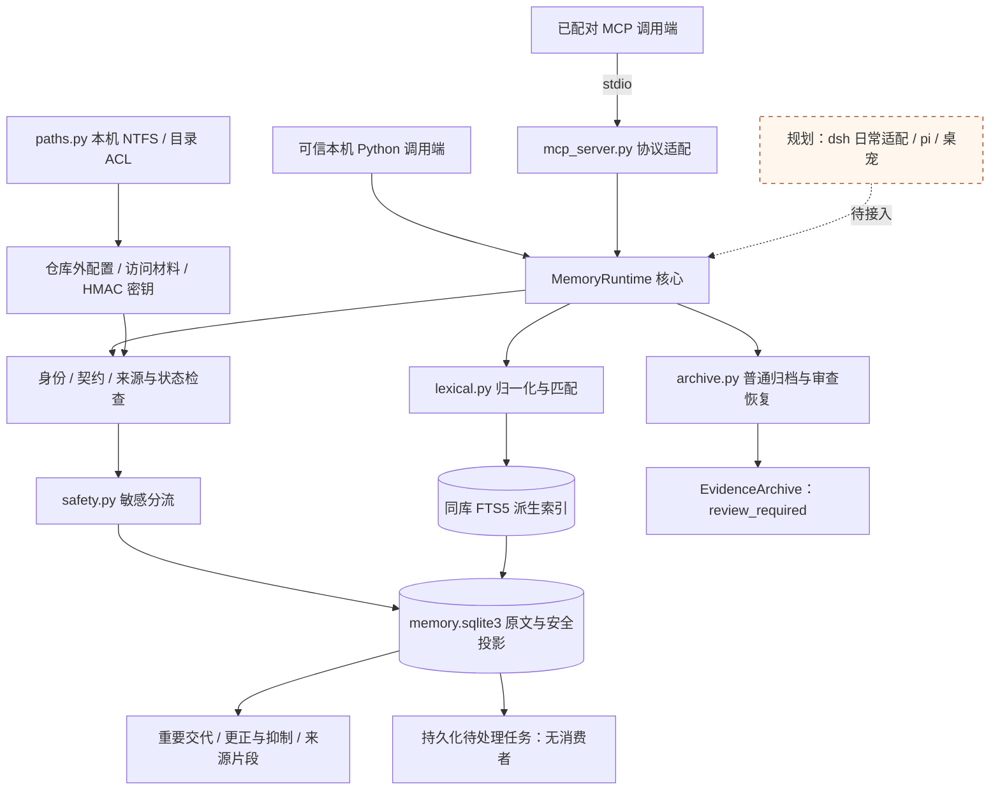
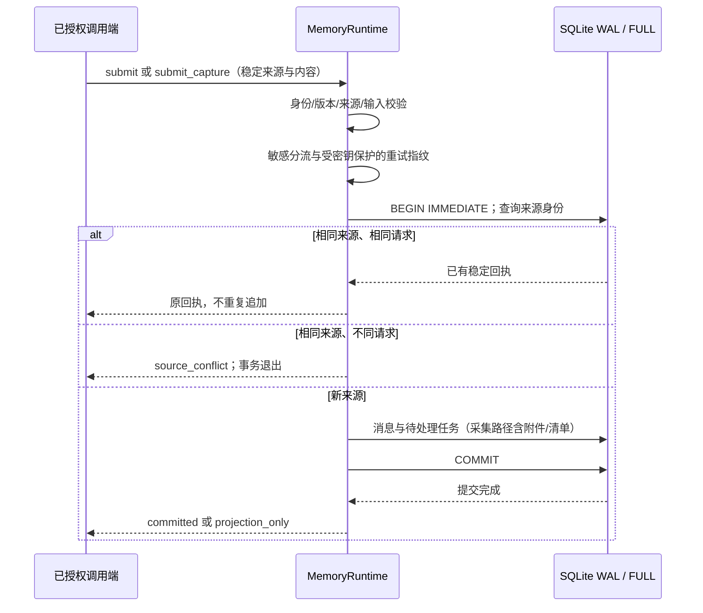
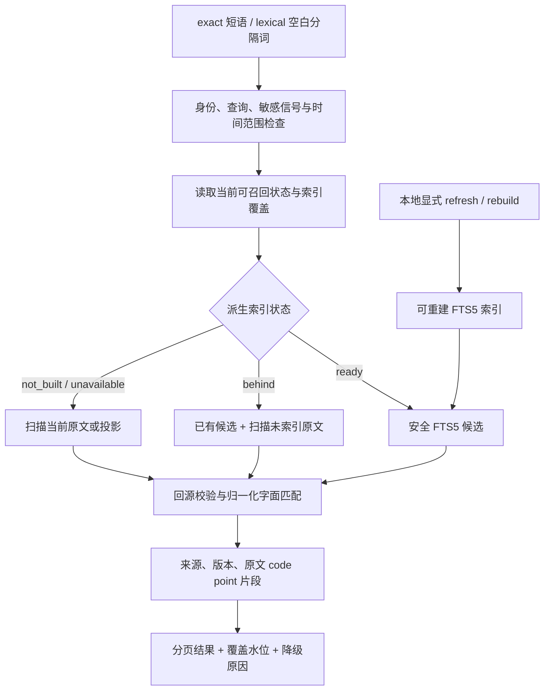
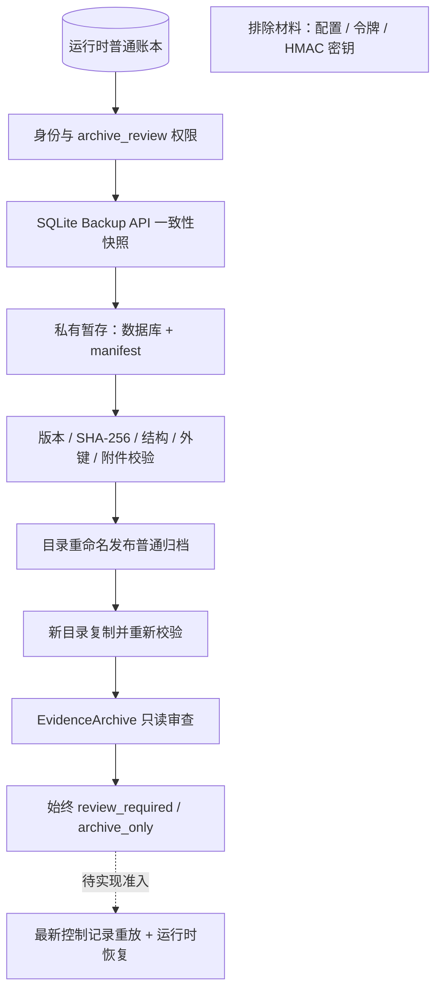

# 当前实现与架构图

更新：2026-10-30，业务代码基线 `64158d7`，位于 `codex/r1-archive-recovery`，尚未合并 main。本页依据源码与契约描述已有能力；[目标架构](architecture.md)和[验收路线](roadmap.md)中的后续设计不代表已经实现。

## 系统结构

当前交付是 Python 本地库与可选 stdio MCP 适配器。不同实例可读取同一配置和 SQLite 账本，但尚无已部署的共享守护服务、HTTP 监听或日常宿主自动采集链路。核心无第三方运行依赖；MCP 为可选依赖。

实线表示已存在的调用或数据关联，虚线表示规划接入；图中各模块不是独立服务。配置、访问材料、数据库、归档和模型资产均位于 checkout 外。ACL 防止普通其他账户直接访问文件，不隔离同账户恶意代码或管理员。

| 源码 | 当前职责 |
|---|---|
| [runtime.py](../src/evernook/runtime.py) | 配置/配对、鉴权、SQLite 事务、幂等、原文/附件、重要交代、更正/抑制与词法维护入口 |
| [models.py](../src/evernook/models.py) | 版本化输入、来源、回执、状态、分页和检索结果 |
| [safety.py](../src/evernook/safety.py)、[paths.py](../src/evernook/paths.py) | 有限凭证信号检测，以及受支持文件系统与运行目录权限检查 |
| [lexical.py](../src/evernook/lexical.py) | Unicode 归一化、中文 1/2/3 字 gram、安全词项与原文坐标映射 |
| [mcp_server.py](../src/evernook/mcp_server.py) | 10 个 stdio 工具与固定失败回执，复用核心检查 |
| [archive.py](../src/evernook/archive.py) | 一致性普通快照、清单/哈希校验、恢复发布与只读归档审查 |
| [tests/contracts](../tests/contracts) | 公开边界的合成回归，含真实 stdio、并发与进程退出场景 |
| [probes](../probes) | R0 宿主、模型和加密原语实验，不作为正式适配器或启用状态 |

## 写入与保存确认

来源为入口、会话、分支、源事件 ID 的组合；相同文本的不同真实事件分别保留。SQLite 提交失败不能返回成功。核心使用短事务，尚无统一后台写调度器或抽取消费者。

保险库关闭时，声明或检测为敏感的内容只保存投影，并明确 `original_saved=false`；有限检测不保证任意秘密均可识别。重要标记、更正/抑制是各自显式操作，不应从上图推断一次普通提交会自动完成它们。

工具与有界文本附件保存在同一数据库事务内，缺失、超限、不支持和未完成内容报告采集缺口。当前接口不实现持续上传或逐 token 显示。dsh 的显示前持久化屏障仍是固定内核探针，实际展示通道、重试与恢复回放尚未验收。契约见[原文](contracts/python-text-v1.md)、[采集](contracts/capture-v1.md)、[重要交代](contracts/important-v1.md)与[显式变更](contracts/changes-v1.md)。

## 当前检索与降级

`exact` 对整个短语匹配，`lexical` 对空白分隔词执行 AND；两者均使用派生归一化表示，返回原件或投影对应的坐标。查询文本按字面处理，不执行用户的 FTS 语法。

普通读取和候选路径过滤已更正、撤销或抑制的消息；索引维护提交前重新核验来源状态。索引落后时补扫未处理原文；索引失败时扫描原文，明确报告覆盖缺口。水位是最大接收时间，不能代替连续完成证明。原文数据库失败仍报存储错误，不伪造空结果。

独立附件内容尚未进入全文检索。时间过滤依据已有事件时间，不具备自然语言历史事实推断。目前没有 embedding、语义融合、重排、七天独立预算或最终上下文预算构造；模型实验不能算正式召回链路。详见[词法契约](contracts/lexical-v1.md)。

## 普通导出与受控恢复

普通归档是未加密的用户证据，包含已失效原档供明确审查；它不是可自动接管的运行时备份。新目录恢复不生成配置或密钥，不提供普通 `read/search/submit`。无法证明快照之后的更正/抑制/删除完整，因此没有把恢复副本转为可召回状态的接口。图中虚线仅表示后续准入缺口，排除材料不进入归档。详见[归档契约](contracts/archive-v1.md)和[实施验证](reports/r1-export-2026-10-30.md)。

## 实现进度与阶段缺口

| 阶段/能力 | 当前事实 | 尚未完成 |
|---|---|---|
| R0 验证与选型 | 已有 dsh、MemOS 对照和凭证原语探针；原文账本路线已记录 | 全面 OS 断网、正式模型质量、实际宿主集成等准入 |
| R1 可靠底座 | 原文、重要交代、显式更正/抑制、有限附件、普通归档与审查恢复已实现 | 加密备份、目的地/恢复材料、调度/保留、最新控制记录重放、运行时恢复与 RPO/RTO |
| R2 事实与时态 | 有调用端提供派生上下文的来源版本校验入口 | 自动抽取、候选/争议、多来源事实、纠错与现实变化区分、历史有效期 |
| R3 召回与沉淀 | 中文词法/精确检索及显式索引维护已实现 | 本地语义、融合/七天配额、预算上下文、日周沉淀、维护调度与模型换代 |
| R4 跨入口与长期运行 | 真实 stdio 协议和两个配对身份共用账本已有回归 | dsh 日常适配、pi、桌宠、安装升级与长期运行验收 |
| 独立安全与质量 | 普通路径分流、ACL 和契约回归已有实现 | 凭证保险库/逐次明文授权、彻底删除、正式质量集与十万/百万规模性能验收 |

MCP 的 10 个工具覆盖文本保存/读取、来源/时间列表、搜索、重要标记/回取、更正、状态与能力。采集附件、配对、词法维护、归档审查和导出目前均不作为 MCP 工具开放。协议回归通过不表示调用端已经配置、自动采集或注入记忆。

上一轮验证记录为 74 项完整回归、归档 8 项增量复验、追加超时 1 项回归及严格 mypy 21 文件检查通过，具体边界见实施报告。本页不将测试数量、R0 小样本耗时或约 1 秒目标解释为生产质量/性能验收。

## 后续推进边界

T09 仍开放，备份按已确认决定继续待办；[T10](https://github.com/destinyTaoTao/evernook/issues/11) 的日常 dsh 链路相关依赖未解除。自动抽取、语义召回及其他任务需要分别落实模型、质量和资源准入。当前页补充实现地图，不改变这些产品决定，也不授权部署、启用或自动执行后续任务。
