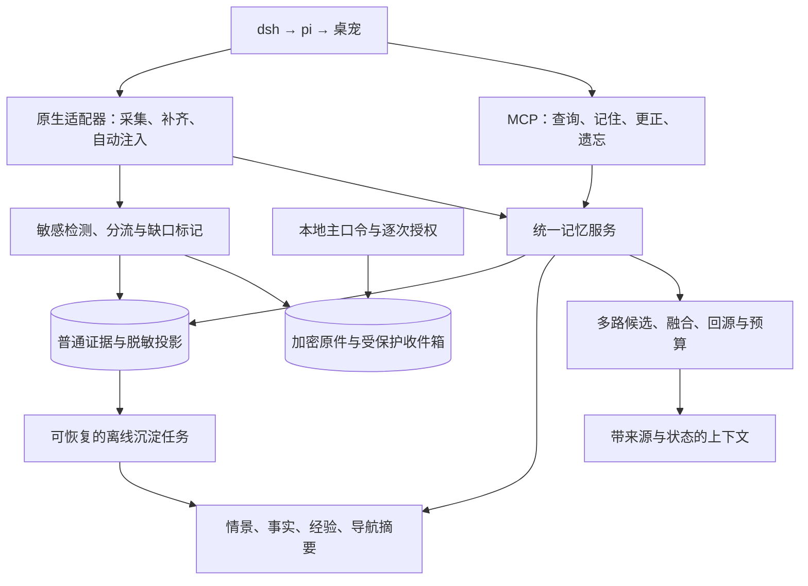

# 统一长期记忆方案：设计讨论

状态：修订版已由用户确认为设计基线；尚未实施，具体组件与模型仍需 R0 验证。确认日期：2026-10-29。

本文汇总本轮明确的选择与推荐方案，不替代尚未完成的复用试验、模型评测和部署验收。术语见 [CONTEXT.md](../CONTEXT.md)。

## 已确认的产品边界

| 决策 | 已确认内容 |
|---|---|
| Q1 本地边界 | 存储、embedding、抽取、重排和沉淀全部离线；记忆失败不自动切云端 |
| Q2 主动更新 | 显式记住立即持久化；无歧义且有来源的事实自动沉淀；明确更正自动生成版本；歧义保留争议并询问；核心人设和关系边界由用户决定 |
| Q3 跨入口 | 桌宠、dsh、pi 等默认是同一个 AI，共享全部记忆；项目标签影响相关性，不构成默认隔离墙 |
| Q4 采集（已修订） | 可获得的用户/助手原文、工具调用及结果、附件原件与来源全量追加；分类不改原文；凭证可选加密保存，普通记忆使用脱敏投影 |
| Q5 接入顺序 | dsh 优先，再接 pi 与桌宠 |
| Q6 培养与学习 | 自动形成有来源的经验记忆；skill/执行规则草案经用户确认才启用 |
| Q7 等待预算 | 普通召回新增等待约 1 秒以内为目标；超时返回已有证据并标明降级；复杂追忆允许深入查询；尚无实测结果 |
| Q8 遗忘语义 | “忘记”默认不再召回且保留原档；“彻底删除”另行明确并处理派生资产和备份边界 |
| Q9 服务职责澄清 | EverNook 由其他端调用，不内置聊天功能或聊天模型开关；返回证据后，调用端负责模型调用与数据出机策略 |
| Q10 部署基线 | 用户指定 32GB 内存、Intel 13600K、RTX 4070；不是本次执行环境的硬件检测结果；显存规格、操作系统和模型占用在部署时核验 |
| Q11 初版反馈 | 用户要求调整，随后补充外挂模块定位、凭证加密保管和专业模块组织；最终确认见 Q16 |
| Q12 身份验证 | 独立保险库主口令，仅在受信任本地界面输入，不进入聊天或模型上下文 |
| Q13 明文交付 | 默认本地展示；指定 harness 按凭证、调用端与本次用途逐次授权 |
| Q14 敏感原件 | 加密保留原件，普通记忆使用脱敏投影与引用；不向普通抽取、索引和摘要提供敏感明文 |
| Q15 锁定写入 | 锁定时允许加密保存至受保护收件箱；解密读取仍需用户验证；加密不可用则明确失败，不回退明文 |
| Q16 修订版确认 | 用户确认按修订版作为设计基线；仅冻结设计，不自动开始业务实现 |

以上产品边界与整体架构方向已确认。具体后端、模型、协议兼容及安全/性能仍需 R0 验证；备份位置等部署参数在对应实施阶段落实。该确认不代表实现、验收或发布已经完成。

## 推荐架构

一个独立本地记忆服务，使用一份权威证据账本，向多个入口提供相同的记忆。推荐以 Python + SQLite 和仓库外附件目录起步，FTS5、sqlite-vec 与成熟中文检索组件做候选。自身只维护满足证据、时间与接入契约的薄编排层，不重写数据库、向量算法或推理引擎；具体组件与模型必须通过 R0 验证。

产品交付形态是外挂记忆模块与宿主插件/MCP 接入：宿主负责聊天与工具，原生插件自动采集/注入，MCP 提供显式操作；内部一个本地运行时承载记忆核心。模块组织见 [architecture.md](architecture.md#模块组织与交付提案)，可选凭证能力见 [credential-security.md](credential-security.md)，不把记忆模块扩成另一个完整 harness。

本地抽取模型与 embedding 是记忆内部依赖，不承担日常聊天。服务输出带来源的证据和上下文建议，由 dsh、pi 或桌宠决定如何调用聊天模型、使用提示和执行工具。EverNook 无法控制客户端收到记忆后的外发行为，不能把服务离线误当成整个调用链离线。

逻辑层次不等于六个数据库，也不强制六个独立服务：

| 层次 | 保存或提供什么 | 更新与召回边界 |
|---|---|---|
| 身份与核心设定 | 核心人设、关系边界、用户确认的行为规则 | 版本化，有限常驻预算；后台不能自行改成执行规则 |
| 工作上下文 | 当前会话、近期指代、正在处理的问题 | 有界窗口；跨会话恢复时加载相关进展，不复制所有历史 |
| 原始证据 | 全量可采集交流与附件 | 普通原件正常追加，敏感原件加密；日常回源使用脱敏投影，敏感原文另行授权；缺口与未完成状态明确标记 |
| 情景与共同经历 | 事件、对话片段、参与人、时间与会话分支 | 由原文派生；区分真实交流、引用、角色扮演和废弃分支 |
| 事实与重要交代 | 偏好、关系、承诺、现状、历史及明确要求记住的原话 | 时间版本、来源校验、纠错与争议；重要原话有确定性回取路径 |
| 经验与成长 | 有证据的成功流程、失败教训、交流偏好、技能草案 | 经验可自动归纳；规则启用需用户确认；不自行训练模型权重 |

“最近七天”是跨层召回视图；“时间版本”和“重要程度”是跨层属性。日/周/主题摘要与类似 MEMORY.md 的小索引负责导航，不替代以上证据。

## 写入、主动记忆与周期沉淀

1. **先保存证据**：先做敏感分流，再提交来源 ID、会话/分支、顺序、普通原件或脱敏投影及受保护引用；原件持久化成功才返回对应保存确认。敏感原件/附件先可靠写入，再通过幂等关联提交回执；中断后可恢复，失败不返回完整采集成功。
2. **显式记住立即生效**：重要标记与原文引用同步持久化，不等待向量、摘要或本地抽取模型。刚确认的更正立即影响后续查询，不能被后台旧任务重新覆盖。
3. **自动发现重要信息**：本地抽取器识别偏好、持续目标、承诺、关系变化、纠正与重复出现的高价值信息。助手生成内容、第三方引文和模型置信分不能单独证明用户事实；含糊内容保留候选状态。
4. **增量任务**：对新证据抽取、分类、切片、embedding；持久化队列与成功水位同事务推进，按来源范围和处理版本幂等。所有派生结果可回到原文。
5. **闲时维护**：建议在会话空闲、压缩前或关闭前尝试抽取待办，但最终可靠性依赖已提交的账本和可恢复任务，不能依赖“退出时再保存”。
6. **周期整理**：建议提供每日情景归纳、每周主题/经验整合和索引检查；睡眠或关机错过后合并补跑，不补发无意义的多次任务。每轮都有时间、CPU、数量和上下文预算，交互请求优先。
7. **不因冷落销毁原文**：使用频次只调整摘要与索引优先级，不能把几年没问到的重要交代从档案淘汰。是否启用更重的反思、重排或关系推理由评测决定。

周期任务属于拟议服务能力；本次没有注册 Codex 自动化、系统定时任务或运行后台进程。

## 多路召回与约 1 秒目标

- **精确路径**：记忆/消息 ID、重要原话、名称、数字与明确日期；普通原话直接回源，敏感部分返回脱敏引用，授权后走保险库还原。
- **中文词法路径**：全文、短词、专名、否定与英文混排；使用成熟分词/索引，不能误把 unicode61 当中文分词器。
- **语义路径**：本地 query embedding，匹配事实、情景及有来源片段；模型和分块版本隔离。
- **时间路径**：滚动七天独立候选配额，同时保留全历史预算；分别识别“现在”和“当时”。
- **实体与关系路径**：先用主体、别名和关系表约束候选；复杂图遍历作为后续候选，不为“多一种召回”先增加图数据库。
- **导航路径**：小索引、日/周/主题摘要引导到详细记忆与原文；摘要不能直接取代证据回答。

先过滤有效性与遗忘限制，再用 RRF 等基线融合、来源去重、必要上下文扩展与 token 预算。可选重排只能消耗剩余预算；查到来源不代表模型生成一定忠实，需分别评分。

常规路径使用预计算向量与有界缓存，不对每个问题调用本地大模型做全库推理。超时取消未完成的重查询，返回证据、水位、缺口和降级状态；不能把索引尚未追平说成“从未发生”。深入查询单独设预算。

约 1 秒目标涵盖请求调度、query embedding、候选、融合、回源和上下文构造；不含聊天生成，不能用 SQLite 单条查询耗时充当成绩。总交互延迟仍另报原文写入和适配器开销。既有数据库路径目标见 [roadmap.md](roadmap.md)。

## 接入与配置边界

统一服务提供版本化本地契约；MCP 提供显式记忆工具；dsh/pi 原生适配器负责每轮自动捕获、召回注入和生命周期事件。MCP 的存在不保证模型一定调用它，也不保证宿主向它提供全部交流。

建议一个常驻服务负责账本和后台任务，适配器通过本机接口访问；MCP 作为同一服务的工具入口，避免每个客户端另起一套记忆数据库和沉淀 Worker。仅监听本机，使用本地访问凭证与基本来源校验；“默认共享”适用于用户自己的已授权入口。常驻模型、并发和后台批大小按 4070 实测约束，避免沉淀任务持续占满推理资源而拖慢前台召回。

每个适配器必须报告覆盖能力、源事件 ID、采集水位、分支与完成状态，支持重复投递及已持久化宿主记录的重扫补齐。若宿主不能等待原文提交，也没有耐崩溃本地发件箱，则该链路不能宣称已确认保存；宿主未暴露或未持久化的内容无法凭空补回。

分类维度建议包括来源入口、项目、主题、人物、事件、时间、信息类型、证据性质、状态和重要性；分类与改名都修改派生标签，不移动或改写唯一原文。跨入口按来源 ID 去重，不因文本相同就合并两次真实发生的交流。

开关按功能组设计，先提供可理解的默认配置，再暴露必要细项：

| 配置组 | 推荐控制范围 |
|---|---|
| 本地与模型 | 离线模型位置、允许的本地推理地址、推理资源预算；禁止记忆组件云端 fallback 与运行遥测；模型预先下载 |
| 采集 | 文本/工具/附件覆盖、敏感分流与加密保存、单附件上限与超限缺口；不能静默截断后标为全量 |
| 召回 | 普通/深入预算、七天配额、上下文大小、语义召回/重排/关系路径开关 |
| 沉淀 | 自动抽取、空闲阈值、每日/每周计划、资源预算；暂停沉淀仍保留采集与显式记住 |
| 培养 | 经验归纳与技能建议开关；核心规则启用始终经用户确认 |
| 凭证 | 保存/加密采集/允许申请明文分别配置；普通召回只返回引用或脱敏值，明文始终单独授权 |
| 数据维护 | 不再召回、彻底删除、导出、备份目的地与保留期、恢复检查 |

“不再召回”需要证据级抑制标记，索引重建、后续归纳和缓存不能把它复活；彻底删除还需处理关联原文、附件、受保护副本、派生来源和可控备份，混合摘要应按剩余证据重建。凭证识别不能承诺零漏检；无法检查的附件进入受保护隔离区，不能进入普通索引。

从旧备份恢复也必须处理后来发生的撤销与删除；恢复流程需核对更新的抑制/删除记录，不能恢复完成就直接开放召回。无法取得完整变更记录时，应明确提示恢复边界并先审查，而不是宣称遗忘状态仍然完整。

## 复用选择与验收顺序

先把 MemOS 本地插件与最小自建方案放在同一套中文合成数据上比较。MemOS 当前已有 dsh 适配，但上游披露的崩溃漏采与默认遥测等设置需单独解决，不能直接替代账本。Python 与 TypeScript 跨运行时的桥接成本也纳入比较。[新增调研证据](research.md#补充核验跨入口与周期沉淀)

1. **R0 复用与接入验证**：dsh 能否先提交证据再调用模型；断网时完成抽取、embedding 和重建；比较中文短词、跨年召回与完整时延；凭证后端验证锁定写入、主口令、逐次授权及恢复，未通过不启用。
2. **R1 可靠记忆底座**：幂等追加、显式重要交代、更正/抑制标记、导出与恢复；中断、磁盘满、重复投递和流式失败测试。
3. **R2 记忆质量**：现实/引用/角色扮演分离；误述纠正、现实变化、未来计划、历史时点与后台旧任务并发回归。
4. **R3 完整召回与沉淀**：多路融合、七天预算、约 1 秒常规目标、日/周归纳与恢复补跑；用 10 万/100 万消息候选规模验证。
5. **R4 经验成长与换入口**：经验来源、技能启用审批、pi 再桌宠接入；跨入口共享与来源分支保留、备份恢复和长期运行验收。

整体设计已确认；后续工作从 R0 开始验证复用内核和本地模型，本次确认不自动启动业务实现。备份目的地、容量与加密/密钥恢复、部署打包方式和最终端到端门槛在对应实施阶段落实；当前不声称这些配置已经完成。
